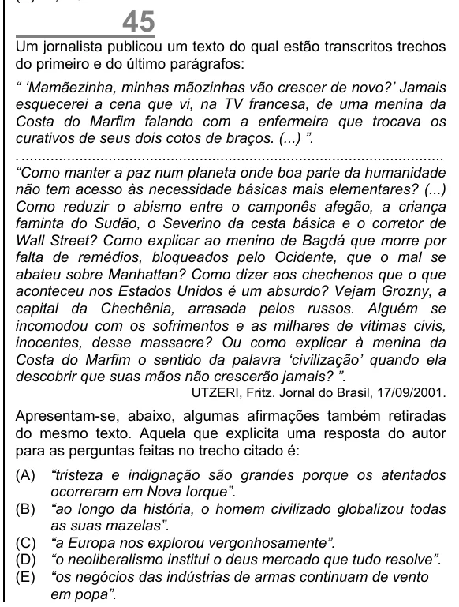

Texto extraído (pode conter ruído)

45  
Um jornalista publicou um texto do qual estão transcritos trechos  
do primeiro e do último parágrafos:  
“ ‘Mamãezinha, minhas mãozinhas vão crescer de novo?’ Jamais  
esquecerei a cena que vi, na TV francesa, de uma menina da  
Costa do Marfim falando com a enfermeira que trocava os  
curativos de seus dois cotos de braços. (...) ”.  
. ......................................................................................................  
“Como manter a paz num planeta onde boa parte da humanidade  
não tem acesso às necessidade básicas mais elementares? (...)  
Como reduzir o abismo entre o camponês afegão, a criança  
faminta do Sudão, o Severino da cesta básica e o corretor de  
Wall Street? Como explicar ao menino de Bagdá que morre por  
falta de remédios, bloqueados pelo Ocidente, que o mal se  
abateu sobre Manhattan? Como dizer aos chechenos que o que  
aconteceu nos Estados Unidos é um absurdo? Vejam Grozny, a  
capital da Chechênia, arrasada pelos russos. Alguém se  
incomodou com os sofrimentos e as milhares de vítimas civis,  
inocentes, desse massacre? Ou como explicar à menina da  
Costa do Marfim o sentido da palavra ‘civilização’ quando ela  
descobrir que suas mãos não crescerão jamais? ”.  
UTZERI, Fritz. Jornal do Brasil, 17/09/2001.  
Apresentam-se, abaixo, algumas afirmações também retiradas  
do mesmo texto. Aquela que explicita uma resposta do autor  
para as perguntas feitas no trecho citado é:  
(A)  
“tristeza e indignação são grandes porque os atentados  
ocorreram em Nova Iorque”.  
(B) “ao longo da história, o homem civilizado globalizou todas  
as suas mazelas”.  
(C) “a Europa nos explorou vergonhosamente”.  
(D) “o neoliberalismo institui o deus mercado que tudo resolve”.  
(E) “os negócios das indústrias de armas continuam de vento  
em popa”.

