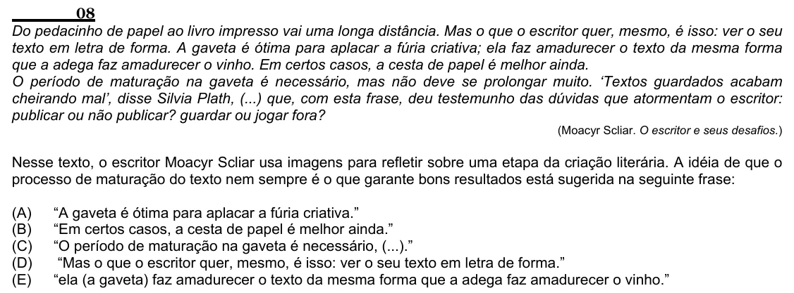

Texto extraído (pode conter ruído)

08  
Do pedacinho de papel ao livro impresso vai uma longa distância. Mas o que o escritor quer, mesmo, é isso: ver o seu  
texto em letra de forma. A gaveta é ótima para aplacar a fúria criativa; ela faz amadurecer o texto da mesma forma  
que a adega faz amadurecer o vinho. Em certos casos, a cesta de papel é melhor ainda.  
O período de maturação na gaveta é necessário, mas não deve se prolongar muito. ‘Textos guardados acabam  
cheirando mal’, disse Silvia Plath, (...) que, com esta frase, deu testemunho das dúvidas que atormentam o escritor:  
publicar ou não publicar? guardar ou jogar fora?  
(Moacyr Scliar. O escritor e seus desafios.)  
Nesse texto, o escritor Moacyr Scliar usa imagens para refletir sobre uma etapa da criação literária. A idéia de que o  
processo de maturação do texto nem sempre é o que garante bons resultados está sugerida na seguinte frase:  
(A)  
“A gaveta é ótima para aplacar a fúria criativa.”  
(B)  
“Em certos casos, a cesta de papel é melhor ainda.”  
(C)  
“O período de maturação na gaveta é necessário, (...).”  
(D)  
“Mas o que o escritor quer, mesmo, é isso: ver o seu texto em letra de forma.”  
(E)  
“ela (a gaveta) faz amadurecer o texto da mesma forma que a adega faz amadurecer o vinho.”

