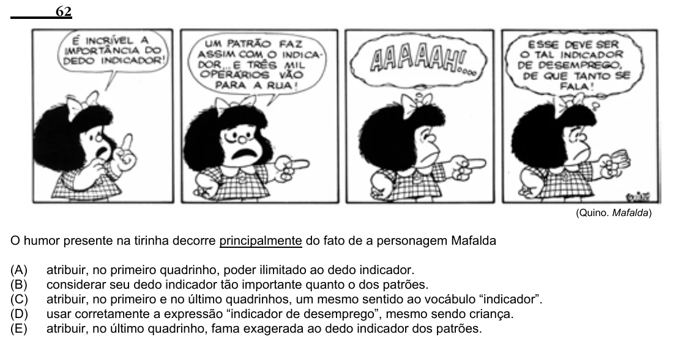

Texto extraído (pode conter ruído)

62  
(Quino. Mafalda)  
O humor presente na tirinha decorre principalmente do fato de a personagem Mafalda  
(A)  
atribuir, no primeiro quadrinho, poder ilimitado ao dedo indicador.  
(B)  
considerar seu dedo indicador tão importante quanto o dos patrões.  
(C)  
atribuir, no primeiro e no último quadrinhos, um mesmo sentido ao vocábulo “indicador”.  
(D)  
usar corretamente a expressão “indicador de desemprego”, mesmo sendo criança.  
(E)  
atribuir, no último quadrinho, fama exagerada ao dedo indicador dos patrões.

