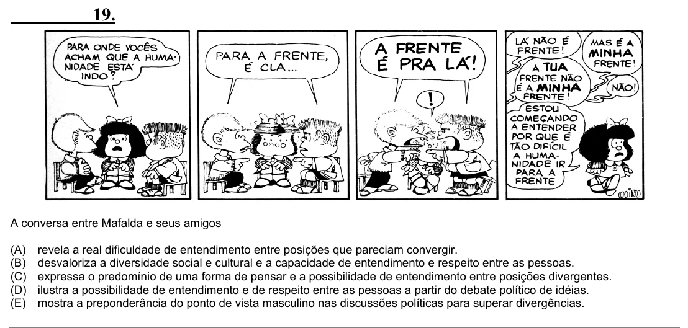

Texto extraído (pode conter ruído)

19.  
A conversa entre Mafalda e seus amigos  
(A)  
revela a real dificuldade de entendimento entre posições que pareciam convergir.  
(B)  
desvaloriza a diversidade social e cultural e a capacidade de entendimento e respeito entre as pessoas.  
(C)  
expressa o predomínio de uma forma de pensar e a possibilidade de entendimento entre posições divergentes.  
(D)  
ilustra a possibilidade de entendimento e de respeito entre as pessoas a partir do debate político de idéias.  
(E)  
mostra a preponderância do ponto de vista masculino nas discussões políticas para superar divergências.

