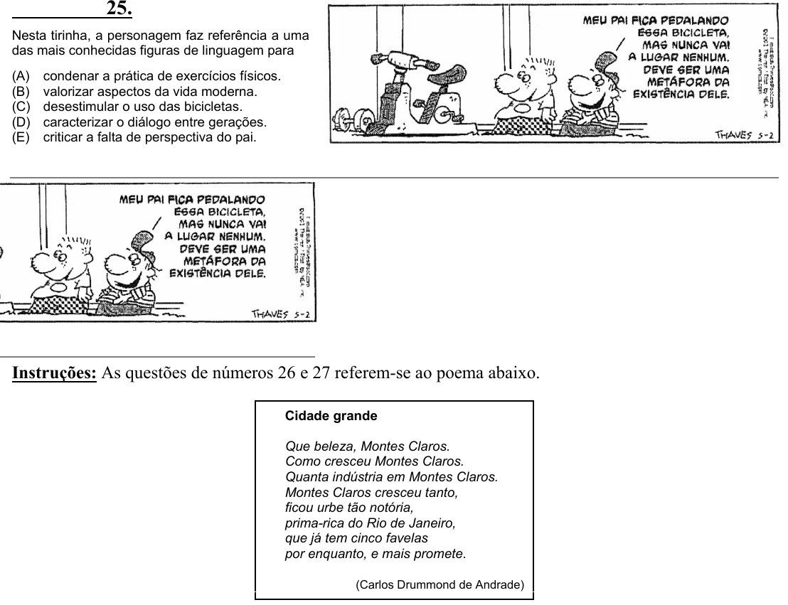

Texto extraído (pode conter ruído)

Nesta tirinha, a personagem faz referência a uma  
das mais conhecidas figuras de linguagem para  
(A)  
condenar a prática de exercícios físicos.  
(B)  
valorizar aspectos da vida moderna.  
(C)  
desestimular o uso das bicicletas.  
(D)  
caracterizar o diálogo entre gerações.  
(E)  
criticar a falta de perspectiva do pai.  
  
Instruções: As questões de números 26 e 27 referem-se ao poema abaixo.  
Cidade grande  
Que beleza, Montes Claros.  
Como cresceu Montes Claros.  
Quanta indústria em Montes Claros.  
Montes Claros cresceu tanto,  
ficou urbe tão notória,  
prima-rica do Rio de Janeiro,  
que já tem cinco favelas  
por enquanto, e mais promete.  
(Carlos Drummond de Andrade)

