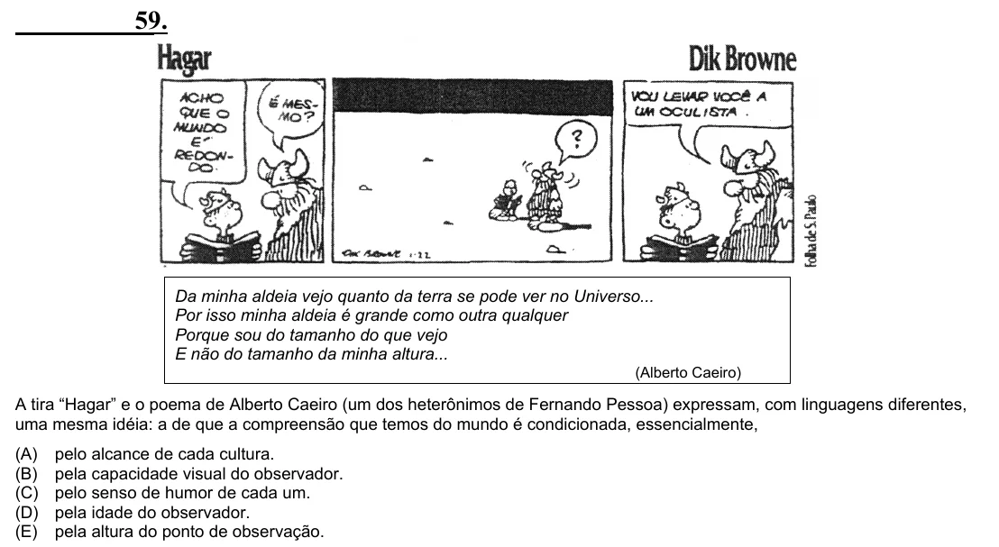

Texto extraído (pode conter ruído)

59.  
Da minha aldeia vejo quanto da terra se pode ver no Universo...  
Por isso minha aldeia é grande como outra qualquer  
Porque sou do tamanho do que vejo  
E não do tamanho da minha altura...  
(Alberto Caeiro)  
A tira “Hagar” e o poema de Alberto Caeiro (um dos heterônimos de Fernando Pessoa) expressam, com linguagens diferentes,  
uma mesma idéia: a de que a compreensão que temos do mundo é condicionada, essencialmente,  
(A)  
pelo alcance de cada cultura.  
(B)  
pela capacidade visual do observador.  
(C)  
pelo senso de humor de cada um.  
(D)  
pela idade do observador.  
(E)  
pela altura do ponto de observação.

