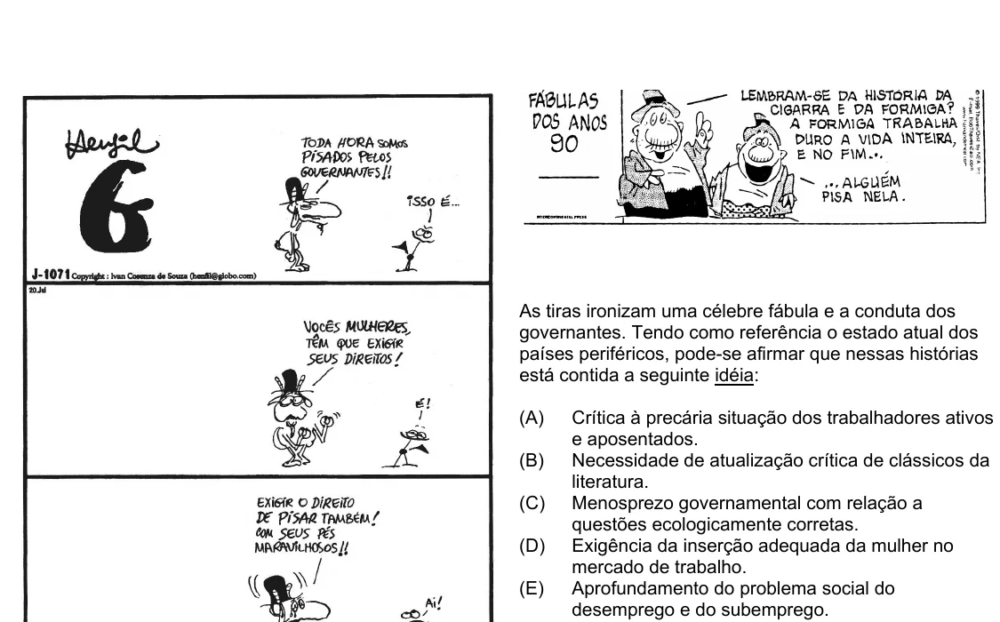

Texto extraído (pode conter ruído)

As tiras ironizam uma célebre fábula e a conduta dos  
governantes. Tendo como referência o estado atual dos  
países periféricos, pode-se afirmar que nessas histórias  
está contida a seguinte idéia:  
(A)  
Crítica à precária situação dos trabalhadores ativos  
e aposentados.  
(B)  
Necessidade de atualização crítica de clássicos da  
literatura.  
(C)  
Menosprezo governamental com relação a  
questões ecologicamente corretas.  
(D)  
Exigência da inserção adequada da mulher no  
mercado de trabalho.  
(E)  
Aprofundamento do problema social do  
desemprego e do subemprego.

