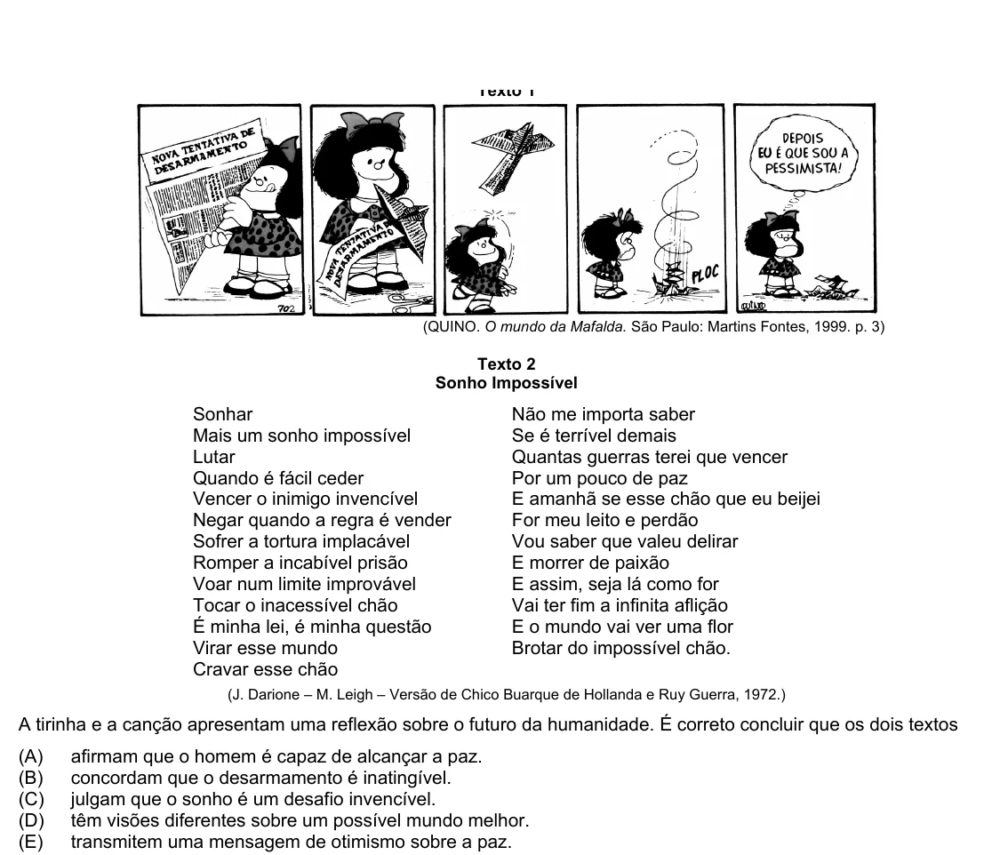

Texto extraído (pode conter ruído)

(QUINO. O mundo da Mafalda. São Paulo: Martins Fontes, 1999. p. 3)  
Texto 2  
Sonho Impossível  
Sonhar  
Não me importa saber  
Mais um sonho impossível  
Se é terrível demais  
Lutar  
Quantas guerras terei que vencer  
Quando é fácil ceder  
Por um pouco de paz  
Vencer o inimigo invencível  
E amanhã se esse chão que eu beijei  
Negar quando a regra é vender  
For meu leito e perdão  
Sofrer a tortura implacável  
Vou saber que valeu delirar  
Romper a incabível prisão  
E morrer de paixão  
Voar num limite improvável  
E assim, seja lá como for  
Tocar o inacessível chão  
Vai ter fim a infinita aflição  
É minha lei, é minha questão  
E o mundo vai ver uma flor  
Virar esse mundo  
Brotar do impossível chão.  
Cravar esse chão  
(J. Darione – M. Leigh – Versão de Chico Buarque de Hollanda e Ruy Guerra, 1972.)  
A tirinha e a canção apresentam uma reflexão sobre o futuro da humanidade. É correto concluir que os dois textos  
(A)  
afirmam que o homem é capaz de alcançar a paz.  
(B)  
concordam que o desarmamento é inatingível.  
(C)  
julgam que o sonho é um desafio invencível.  
(D)  
têm visões diferentes sobre um possível mundo melhor.  
(E)  
transmitem uma mensagem de otimismo sobre a paz.

