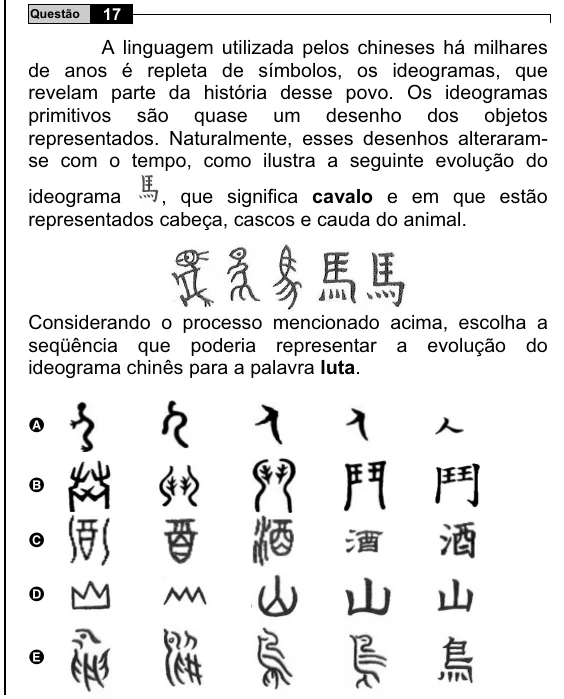

Texto extraído (pode conter ruído)

Questão  
17  
A linguagem utilizada pelos chineses há milhares  
de anos é repleta de símbolos, os ideogramas, que  
revelam parte da história desse povo. Os ideogramas  
primitivos são quase um desenho dos objetos  
representados. Naturalmente, esses desenhos alteraram-  
se com o tempo, como ilustra a seguinte evolução do  
, que significa cavalo e em que estão  
ideograma  
representados cabeça, cascos e cauda do animal.  
Considerando o processo mencionado acima, escolha a  
seqüência que poderia representar a evolução do  
ideograma chinês para a palavra luta.  
A  
B  
C  
D  
E

