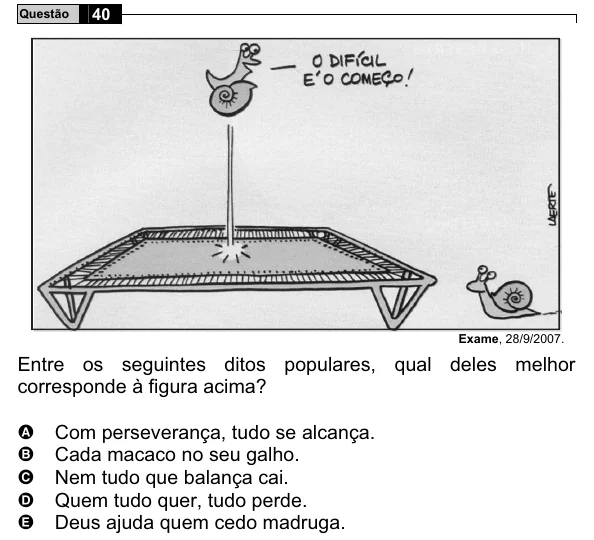

Texto extraído (pode conter ruído)

Questão  
40  
Exame, 28/9/2007.  
Entre os seguintes ditos populares, qual deles melhor  
corresponde à figura acima?  
A  
Com perseverança, tudo se alcança.  
Cada macaco no seu galho.  
B  
C  
Nem tudo que balança cai.  
Quem tudo quer, tudo perde.  
D  
Deus ajuda quem cedo madruga.  
E

