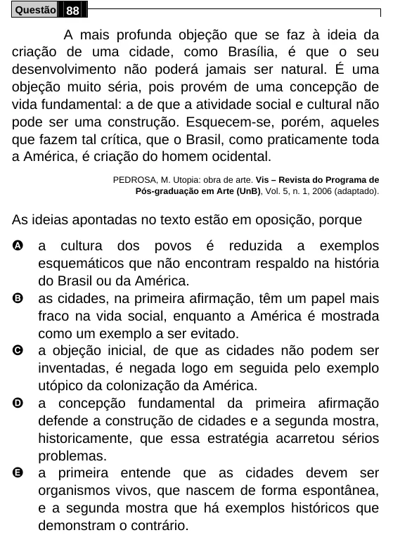

Texto extraído (pode conter ruído)

Questão 88  
A mais profunda objeção que se faz à ideia da  
criação de uma cidade, como Brasília, é que o seu  
desenvolvimento não poderá jamais ser natural. É uma  
objeção muito séria, pois provém de uma concepção de  
vida fundamental: a de que a atividade social e cultural não  
pode ser uma construção. Esquecem-se, porém, aqueles  
que fazem tal crítica, que o Brasil, como praticamente toda  
a América, é criação do homem ocidental.  
PEDROSA, M. Utopia: obra de arte. Vis – Revista do Programa de  
Pós-graduação em Arte (UnB), Vol. 5, n. 1, 2006 (adaptado).  
As ideias apontadas no texto estão em oposição, porque  
A  
a cultura dos povos é reduzida a exemplos  
esquemáticos que não encontram respaldo na história  
do Brasil ou da América.  
B  
as cidades, na primeira afirmação, têm um papel mais  
fraco na vida social, enquanto a América é mostrada  
como um exemplo a ser evitado.  
C  
a objeção inicial, de que as cidades não podem ser  
inventadas, é negada logo em seguida pelo exemplo  
utópico da colonização da América.  
D  
a concepção fundamental da primeira afirmação  
defende a construção de cidades e a segunda mostra,  
historicamente, que essa estratégia acarretou sérios  
problemas.  
E  
a primeira entende que as cidades devem ser  
organismos vivos, que nascem de forma espontânea,  
e a segunda mostra que há exemplos históricos que  
demonstram o contrário.

