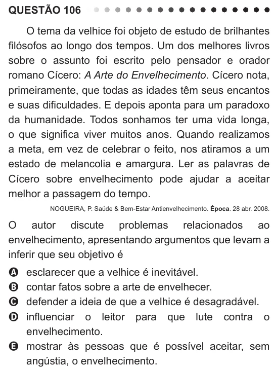

Texto extraído (pode conter ruído)

QUESTÃO 106  
O tema da velhice foi objeto de estudo de brilhantes  
filósofos ao longo dos tempos. Um dos melhores livros  
sobre o assunto foi escrito pelo pensador e orador  
romano Cícero: A Arte do Envelhecimento. Cícero nota,  
primeiramente, que todas as idades têm seus encantos  
e suas dificuldades. E depois aponta para um paradoxo  
da humanidade. Todos sonhamos ter uma vida longa,  
o que significa viver muitos anos. Quando realizamos  
a meta, em vez de celebrar o feito, nos atiramos a um  
estado de melancolia e amargura. Ler as palavras de  
Cícero sobre envelhecimento pode ajudar a aceitar  
melhor a passagem do tempo.  
NOGUEIRA, P. Saúde & Bem-Estar Antienvelhecimento. Época. 28 abr. 2008.  
O autor discute problemas relacionados ao  
envelhecimento, apresentando argumentos que levam a  
inferir que seu objetivo é  
esclarecer que a velhice é inevitável.  
A  
B  
contar fatos sobre a arte de envelhecer.  
defender a ideia de que a velhice é desagradável.  
C  
influenciar o leitor para que lute contra o  
D  
envelhecimento.  
E mostrar às pessoas que é possível aceitar, sem  
angústia, o envelhecimento.

