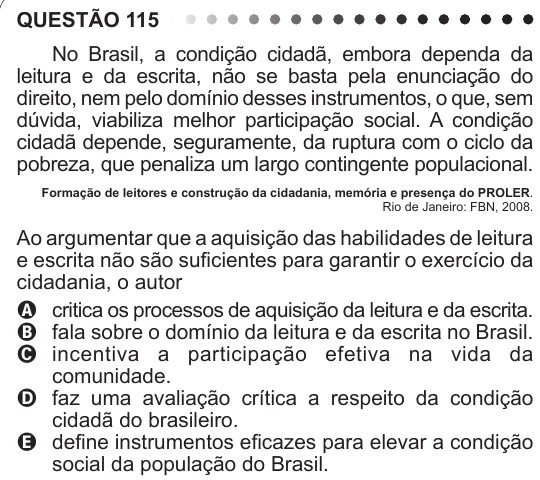

Texto extraído (pode conter ruído)

QUESTÃO 115  
No Brasil, a condição cidadã, embora dependa da  
leitura e da escrita, não se basta pela enunciação do  
direito, nem pelo domínio desses instrumentos, o que, sem  
dúvida, viabiliza melhor participação social. A condição  
cidadã depende, seguramente, da ruptura com o ciclo da  
pobreza, que penaliza um largo contingente populacional.  
Formação de leitores e construção da cidadania, memória e presença do PROLER.  
Rio de Janeiro: FBN, 2008.  
Ao argumentar que a aquisição das habilidades de leitura  
e escrita não são suficientes para garantir o exercício da  
cidadania, o autor  
A critica os processos de aquisição da leitura e da escrita.  
B fala sobre o domínio da leitura e da escrita no Brasil.  
C incentiva a participação efetiva na vida da  
comunidade.  
D faz uma avaliação crítica a respeito da condição  
cidadã do brasileiro.  
E define instrumentos eficazes para elevar a condição  
social da população do Brasil.

