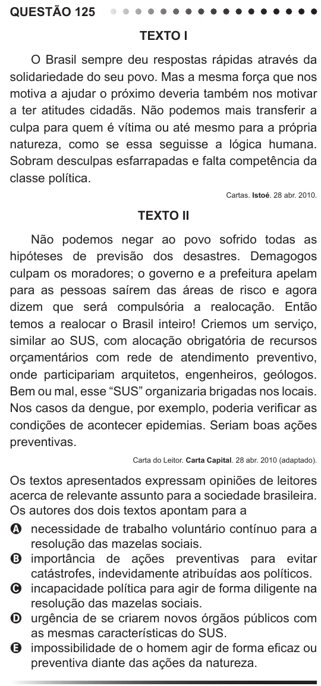

Texto extraído (pode conter ruído)

QUESTÃO 125  
Texto I  
O Brasil sempre deu respostas rápidas através da  
solidariedade do seu povo. Mas a mesma força que nos  
motiva a ajudar o próximo deveria também nos motivar  
a ter atitudes cidadãs. Não podemos mais transferir a  
culpa para quem é vítima ou até mesmo para a própria  
natureza, como se essa seguisse a lógica humana.  
Sobram desculpas esfarrapadas e falta competência da  
classe política.  
Cartas. Istoé. 28 abr. 2010.  
Texto II  
Não podemos negar ao povo sofrido todas as  
hipóteses de previsão dos desastres. Demagogos  
culpam os moradores; o governo e a prefeitura apelam  
para as pessoas saírem das áreas de risco e agora  
dizem que será compulsória a realocação. Então  
temos a realocar o Brasil inteiro! Criemos um serviço,  
similar ao SUS, com alocação obrigatória de recursos  
orçamentários com rede de atendimento preventivo,  
onde participariam arquitetos, engenheiros, geólogos.  
Bem ou mal, esse “SUS” organizaria brigadas nos locais.  
Nos casos da dengue, por exemplo, poderia verificar as  
condições de acontecer epidemias. Seriam boas ações  
preventivas.  
Carta do Leitor. Carta Capital. 28 abr. 2010 (adaptado).  
Os textos apresentados expressam opiniões de leitores  
acerca de relevante assunto para a sociedade brasileira.  
Os autores dos dois textos apontam para a  
A necessidade de trabalho voluntário contínuo para a  
resolução das mazelas sociais.  
B importância de ações preventivas para evitar  
catástrofes, indevidamente atribuídas aos políticos.  
C incapacidade política para agir de forma diligente na  
resolução das mazelas sociais.  
D urgência de se criarem novos órgãos públicos com  
as mesmas características do SUS.  
E impossibilidade de o homem agir de forma eficaz ou  
preventiva diante das ações da natureza.

