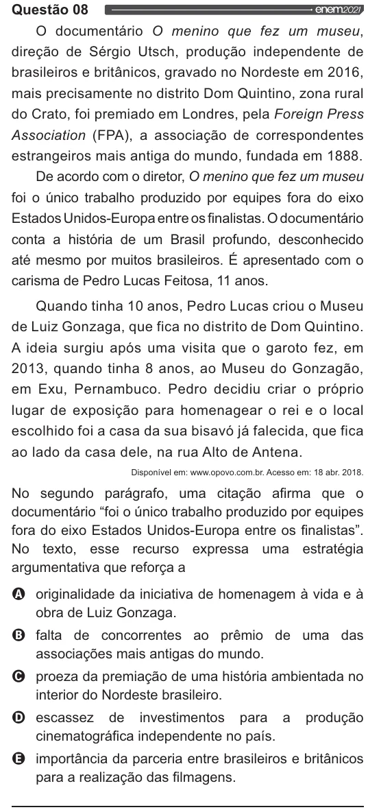

Texto extraído (pode conter ruído)

Questão 08  
enem2021  
O documentário O menino que fez um museu,  
direção de Sérgio Utsch, produção independente de  
brasileiros e britânicos, gravado no Nordeste em 2016,  
mais precisamente no distrito Dom Quintino, zona rural  
do Crato, foi premiado em Londres, pela Foreign Press  
Association (FPA), a associação de correspondentes  
estrangeiros mais antiga do mundo, fundada em 1888.  
De acordo com o diretor, O menino que fez um museu  
foi o único trabalho produzido por equipes fora do eixo  
Estados Unidos-Europa entre os finalistas. O documentário  
conta a história de um Brasil profundo, desconhecido  
até mesmo por muitos brasileiros. É apresentado com o  
carisma de Pedro Lucas Feitosa, 11 anos.  
Quando tinha 10 anos, Pedro Lucas criou o Museu  
de Luiz Gonzaga, que fica no distrito de Dom Quintino.  
A ideia surgiu após uma visita que o garoto fez, em  
2013, quando tinha 8 anos, ao Museu do Gonzagão,  
em Exu, Pernambuco. Pedro decidiu criar o próprio  
lugar de exposição para homenagear o rei e o local  
escolhido foi a casa da sua bisavó já falecida, que fica  
ao lado da casa dele, na rua Alto de Antena.  
Disponível em: www.opovo.com.br. Acesso em: 18 abr. 2018.  
No segundo parágrafo, uma citação afirma que o  
documentário “foi o único trabalho produzido por equipes  
fora do eixo Estados Unidos-Europa entre os finalistas”.  
No texto, esse recurso expressa uma estratégia  
argumentativa que reforça a  
O originalidade da iniciativa de homenagem à vida e à  
obra de Luiz Gonzaga.  
Ooo O v  
falta de concorrentes ao prêmio de uma das  
associações mais antigas do mundo.  
proeza da premiação de uma história ambientada no  
interior do Nordeste brasileiro.  
escassez de investimentos para a produção  
cinematográfica independente no país.  
importância da parceria entre brasileiros e britânicos  
para a realização das filmagens.

