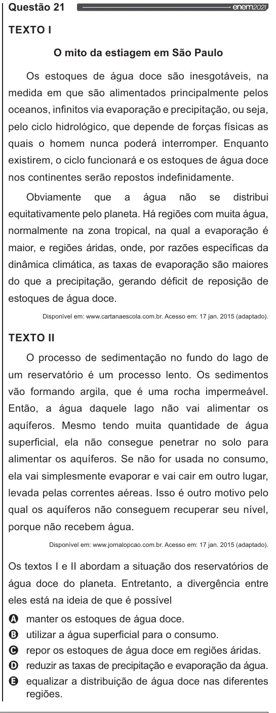

Texto extraído (pode conter ruído)

Questão 21  
TEXTO I  
O mito da estiagem em São Paulo  
Os estoques de água doce são inesgotáveis, na  
medida em que são alimentados principalmente pelos  
oceanos, infinitos via evaporação e precipitação, ou seja,  
pelo ciclo hidrológico, que depende de forças físicas as  
quais o homem nunca poderá interromper. Enquanto  
existirem, o ciclo funcionará e os estoques de água doce  
nos continentes serão repostos indefinidamente.  
Obviamente que a água não se  
distribui  
equitativamente pelo planeta. Há regiões com muita água,  
normalmente na zona tropical, na qual a evaporação é  
maior, e regiões áridas, onde, por razões específicas da  
dinâmica climática, as taxas de evaporação são maiores  
do que a precipitação, gerando déficit de reposição de  
estoques de água doce.  
Disponível em: www.cartanaescola.com.br. Acesso em: 17 jan. 2015 (adaptado).  
TEXTO II  
O processo de sedimentação no fundo do lago de  
um reservatório é um processo lento. Os sedimentos  
vão formando argila, que é uma rocha impermeável.  
Então, a água daquele lago não vai alimentar os  
aquíferos. Mesmo tendo muita quantidade de água  
superficial, ela não consegue penetrar no solo para  
alimentar os aquíferos. Se não for usada no consumo,  
ela vai simplesmente evaporar e vai cair em outro lugar,  
levada pelas correntes aéreas. Isso é outro motivo pelo  
qual os aquíferos não conseguem recuperar seu nível,  
porque não recebem água.  
Disponível em: wwwjornalopcao.com.br. Acesso em: 17 jan. 2015 (adaptado).  
Os textos | e Il abordam a situação dos reservatórios de  
água doce do planeta. Entretanto, a divergência entre  
eles está na ideia de que é possível  
VOVOO  
manter os estoques de água doce.  
utilizar a água superficial para o consumo.  
repor os estoques de água doce em regiões áridas.  
reduzir as taxas de precipitação e evaporação da água.  
equalizar a distribuição de água doce nas diferentes  
regiões.

