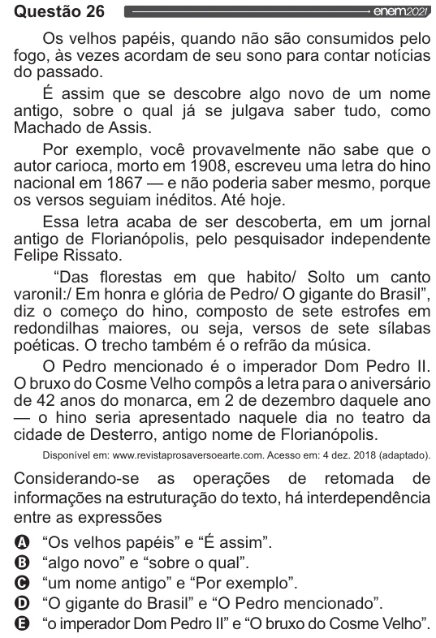

Texto extraído (pode conter ruído)

Questão 26  
Os velhos papéis, quando não são consumidos pelo  
fogo, às vezes acordam de seu sono para contar notícias  
do passado.  
E assim que se descobre algo novo de um nome  
antigo, sobre o qual já se julgava saber tudo, como  
Machado de Assis.  
Por exemplo, você provavelmente não sabe que o  
autor carioca, morto em 1908, escreveu uma letra do hino  
nacional em 1867 — e não poderia saber mesmo, porque  
os versos seguiam inéditos. Até hoje.  
Essa letra acaba de ser descoberta, em um jornal  
antigo de Florianópolis, pelo pesquisador independente  
Felipe Rissato.  
“Das florestas em que habito/ Solto um canto  
varonil:/ Em honra e glória de Pedro/ O gigante do Brasil”,  
diz o começo do hino, composto de sete estrofes em  
redondilhas maiores, ou seja, versos de sete sílabas  
poéticas. O trecho também é o refrão da música.  
O Pedro mencionado é o imperador Dom Pedro ll.  
O bruxo do Cosme Velho compôs a letra para o aniversário  
de 42 anos do monarca, em 2 de dezembro daquele ano  
— o hino seria apresentado naquele dia no teatro da  
cidade de Desterro, antigo nome de Florianópolis.  
Disponível em: www.revistaprosaversoearte.com. Acesso em: 4 dez. 2018 (adaptado).  
Considerando-se as operações de retomada de  
informações na estruturação do texto, há interdependência  
entre as expressões  
O “Os velhos papéis” e “É assim”.  
O “algo novo” e “sobre o qual”.  
O “um nome antigo” e “Por exemplo”.  
O “O gigante do Brasil” e “O Pedro mencionado”.  
OQ “o imperador Dom Pedro II” e “O bruxo do Cosme Velho”.

