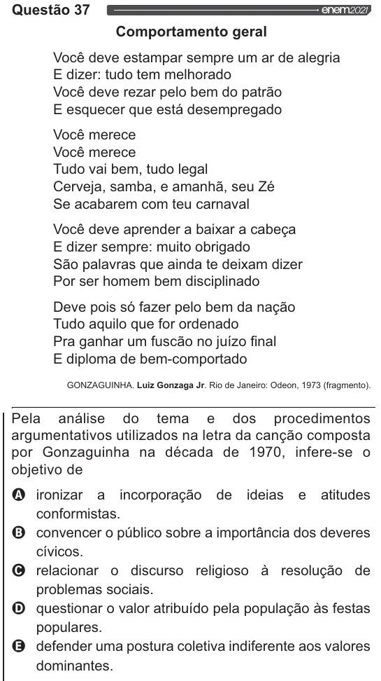

Texto extraído (pode conter ruído)

Questão 37  
Comportamento geral  
Você deve estampar sempre um ar de alegria  
E dizer: tudo tem melhorado  
Você deve rezar pelo bem do patrão  
E esquecer que está desempregado  
Você merece  
Você merece  
Tudo vai bem, tudo legal  
Cerveja, samba, e amanhã, seu Zé  
Se acabarem com teu carnaval  
Você deve aprender a baixar a cabeça  
E dizer sempre: muito obrigado  
São palavras que ainda te deixam dizer  
Por ser homem bem disciplinado  
Deve pois só fazer pelo bem da nação  
Tudo aquilo que for ordenado  
Pra ganhar um fuscão no juízo final  
E diploma de bem-comportado  
GONZAGUINHA. Luiz Gonzaga Jr. Rio de Janeiro: Odeon, 1973 (fragmento).  
Pela análise do tema e dos procedimentos  
argumentativos utilizados na letra da canção composta  
por Gonzaguinha na década de 1970, infere-se o  
objetivo de  
OQ ironizar a ideias e atitudes  
incorporação de  
conformistas.  
& convencer o público sobre a importância dos deveres  
cívicos.  
O relacionar o discurso religioso à resolução de  
problemas sociais.  
O questionar o valor atribuído pela população às festas  
populares.  
& defender uma postura coletiva indiferente aos valores  
dominantes.

