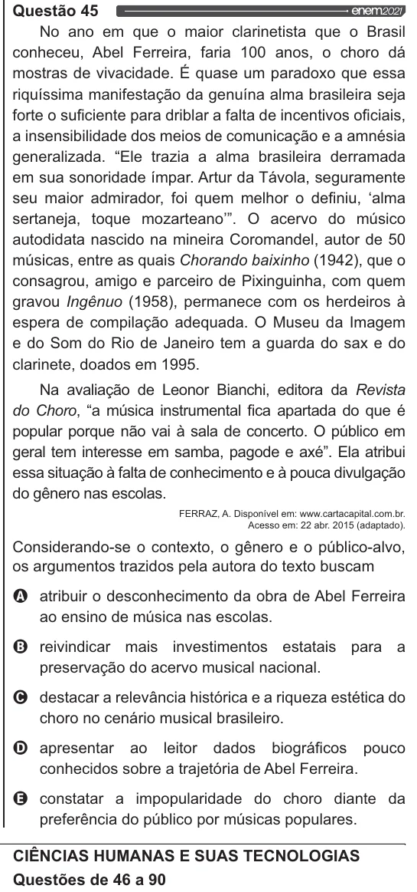

Texto extraído (pode conter ruído)

Questão 45  
No ano em que o maior clarinetista que o Brasil  
conheceu, Abel Ferreira, faria 100 anos, o choro dá  
mostras de vivacidade. É quase um paradoxo que essa  
riquíssima manifestação da genuína alma brasileira seja  
forte o suficiente para driblar a falta de incentivos oficiais,  
a insensibilidade dos meios de comunicação e a amnésia  
generalizada. “Ele trazia a alma brasileira derramada  
em sua sonoridade ímpar. Artur da Távola, seguramente  
seu maior admirador, foi quem melhor o definiu, “alma  
sertaneja, toque mozarteano”. O acervo do músico  
autodidata nascido na mineira Coromandel, autor de 50  
músicas, entre as quais Chorando baixinho (1942), que o  
consagrou, amigo e parceiro de Pixinguinha, com quem  
gravou Ingênuo (1958), permanece com os herdeiros à  
espera de compilação adequada. O Museu da Imagem  
e do Som do Rio de Janeiro tem a guarda do sax e do  
clarinete, doados em 1995.  
Na avaliação de Leonor Bianchi, editora da Revista  
do Choro, “a música instrumental fica apartada do que é  
popular porque não vai à sala de concerto. O público em  
geral tem interesse em samba, pagode e axé”. Ela atribui  
essa situação à falta de conhecimento e à pouca divulgação  
do gênero nas escolas.  
FERRAZ, A. Disponivel em: www.cartacapital.com.br.  
Acesso em: 22 abr. 2015 (adaptado).  
Considerando-se o contexto, o gênero e o público-alvo,  
os argumentos trazidos pela autora do texto buscam  
Q atribuir o desconhecimento da obra de Abel Ferreira  
ao ensino de música nas escolas.  
O reivindicar mais investimentos estatais para a  
preservação do acervo musical nacional.  
O destacar a relevância histórica e a riqueza estética do  
choro no cenário musical brasileiro.  
O apresentar ao leitor dados biográficos pouco  
conhecidos sobre a trajetória de Abel Ferreira.  
Q& constatar a impopularidade do choro diante da  
preferência do público por músicas populares.  
CIÊNCIAS HUMANAS E SUAS TECNOLOGIAS  
Questões de 46 a 90

