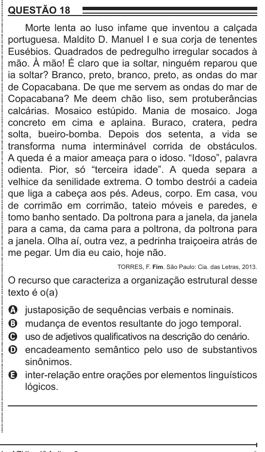

Texto extraído (pode conter ruído)

QUESTÃO 18  
Morte lenta ao luso infame que inventou a calçada  
portuguesa. Maldito D. Manuel I e sua corja de tenentes  
Eusébios. Quadrados de pedregulho irregular socados à  
mão. À mão! É claro que ia soltar, ninguém reparou que  
ia soltar? Branco, preto, branco, preto, as ondas do mar  
de Copacabana. De que me servem as ondas do mar de  
Copacabana? Me deem chão liso, sem protuberâncias  
calcárias. Mosaico estúpido. Mania de mosaico. Joga  
concreto em cima e aplaina. Buraco, cratera, pedra  
solta, bueiro-bomba. Depois dos setenta, a vida se  
transforma numa interminável corrida de obstáculos.  
A queda é a maior ameaça para o idoso. “Idoso”, palavra  
odienta. Pior, só “terceira idade”. A queda separa a  
velhice da senilidade extrema. O tombo destrói a cadeia  
que liga a cabeça aos pés. Adeus, corpo. Em casa, vou  
de corrimão em corrimão, tateio móveis e paredes, e  
tomo banho sentado. Da poltrona para a janela, da janela  
para a cama, da cama para a poltrona, da poltrona para  
a janela. Olha aí, outra vez, a pedrinha traiçoeira atrás de  
me pegar. Um dia eu caio, hoje não.  
TORRES, F. Fim. São Paulo: Cia. das Letras, 2013.  
O recurso que caracteriza a organização estrutural desse  
texto é o(a)  
A  
justaposição de sequências verbais e nominais.  
mudança de eventos resultante do jogo temporal.  
B  
uso de adjetivos qualificativos na descrição do cenário.  
C  
encadeamento semântico pelo uso de substantivos  
D  
sinônimos.  
E inter-relação entre orações por elementos linguísticos  
lógicos.

