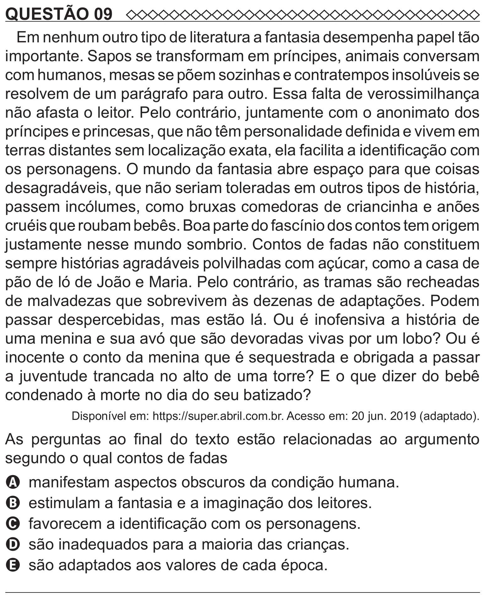

Texto extraído (pode conter ruído)

QUESTÃO 09  
Em nenhum outro tipo de literatura a fantasia desempenha papel tão  
importante. Sapos se transformam em príncipes, animais conversam  
com humanos, mesas se põem sozinhas e contratempos insolúveis se  
resolvem de um parágrafo para outro. Essa falta de verossimilhança  
não afasta o leitor. Pelo contrário, juntamente com o anonimato dos  
príncipes e princesas, que não têm personalidade definida e vivem em  
terras distantes sem localização exata, ela facilita a identificação com  
os personagens. O mundo da fantasia abre espaço para que coisas  
desagradáveis, que não seriam toleradas em outros tipos de história,  
passem incólumes, como bruxas comedoras de criancinha e anões  
cruéis que roubam bebês. Boa parte do fascínio dos contos tem origem  
justamente nesse mundo sombrio. Contos de fadas não constituem  
sempre histórias agradáveis polvilhadas com açúcar, como a casa de  
pão de ló de João e Maria. Pelo contrário, as tramas são recheadas  
de malvadezas que sobrevivem às dezenas de adaptações. Podem  
passar despercebidas, mas estão lá. Ou é inofensiva a história de  
uma menina e sua avó que são devoradas vivas por um lobo? Ou é  
inocente o conto da menina que é sequestrada e obrigada a passar  
a juventude trancada no alto de uma torre? E o que dizer do bebê  
condenado à morte no dia do seu batizado?  
Disponível em: https://super.abril.com.br. Acesso em: 20 jun. 2019 (adaptado).  
As perguntas ao final do texto estão relacionadas ao argumento  
segundo o qual contos de fadas  
A manifestam aspectos obscuros da condição humana.  
B estimulam a fantasia e a imaginação dos leitores.  
C favorecem a identificação com os personagens.  
D são inadequados para a maioria das crianças.  
E são adaptados aos valores de cada época.

