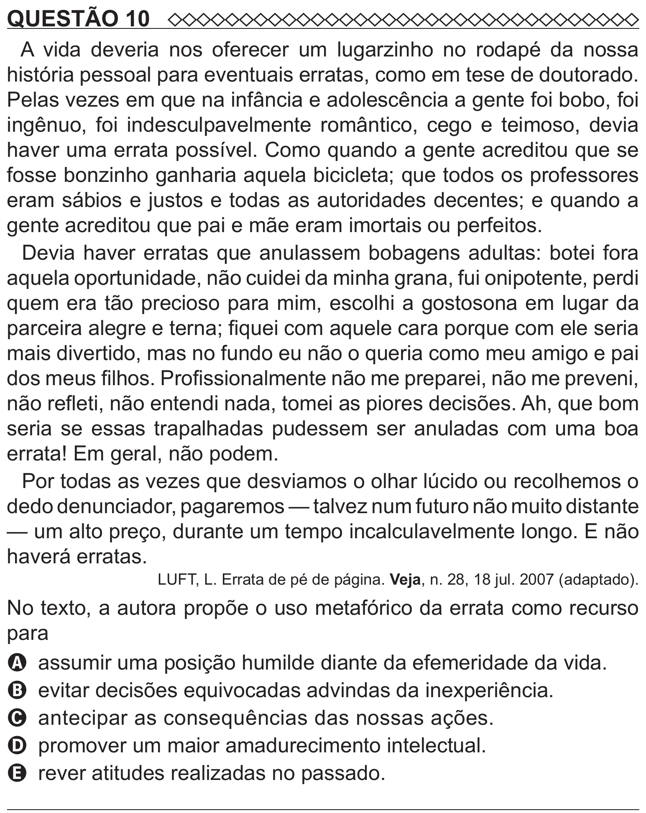

Texto extraído (pode conter ruído)

QUESTÃO 10  
A vida deveria nos oferecer um lugarzinho no rodapé da nossa  
história pessoal para eventuais erratas, como em tese de doutorado.  
Pelas vezes em que na infância e adolescência a gente foi bobo, foi  
ingênuo, foi indesculpavelmente romântico, cego e teimoso, devia  
haver uma errata possível. Como quando a gente acreditou que se  
fosse bonzinho ganharia aquela bicicleta; que todos os professores  
eram sábios e justos e todas as autoridades decentes; e quando a  
gente acreditou que pai e mãe eram imortais ou perfeitos.  
Devia haver erratas que anulassem bobagens adultas: botei fora  
aquela oportunidade, não cuidei da minha grana, fui onipotente, perdi  
quem era tão precioso para mim, escolhi a gostosona em lugar da  
parceira alegre e terna; fiquei com aquele cara porque com ele seria  
mais divertido, mas no fundo eu não o queria como meu amigo e pai  
dos meus filhos. Profissionalmente não me preparei, não me preveni,  
não refleti, não entendi nada, tomei as piores decisões. Ah, que bom  
seria se essas trapalhadas pudessem ser anuladas com uma boa  
errata! Em geral, não podem.  
Por todas as vezes que desviamos o olhar lúcido ou recolhemos o  
dedo denunciador, pagaremos — talvez num futuro não muito distante  
— um alto preço, durante um tempo incalculavelmente longo. E não  
haverá erratas.  
LUFT, L. Errata de pé de página. Veja, n. 28, 18 jul. 2007 (adaptado).  
No texto, a autora propõe o uso metafórico da errata como recurso  
para  
A assumir uma posição humilde diante da efemeridade da vida.  
B evitar decisões equivocadas advindas da inexperiência.  
C antecipar as consequências das nossas ações.  
D promover um maior amadurecimento intelectual.  
E rever atitudes realizadas no passado.

