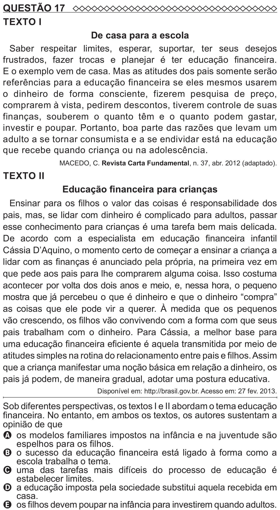

Texto extraído (pode conter ruído)

QUESTÃO 17  
TEXTO I  
De casa para a escola  
Saber respeitar limites, esperar, suportar, ter seus desejos  
frustrados, fazer trocas e planejar é ter educação financeira.  
E o exemplo vem de casa. Mas as atitudes dos pais somente serão  
referências para a educação financeira se eles mesmos usarem  
o dinheiro de forma consciente, fizerem pesquisa de preço,  
comprarem à vista, pedirem descontos, tiverem controle de suas  
finanças, souberem o quanto têm e o quanto podem gastar,  
investir e poupar. Portanto, boa parte das razões que levam um  
adulto a se tornar consumista e a se endividar está na educação  
que recebe quando criança ou na adolescência.  
MACEDO, C. Revista Carta Fundamental, n. 37, abr. 2012 (adaptado).  
TEXTO II  
Educação financeira para crianças  
Ensinar para os filhos o valor das coisas é responsabilidade dos  
pais, mas, se lidar com dinheiro é complicado para adultos, passar  
esse conhecimento para crianças é uma tarefa bem mais delicada.  
De acordo com a especialista em educação financeira infantil  
Cássia D’Aquino, o momento certo de começar a ensinar a criança a  
lidar com as finanças é anunciado pela própria, na primeira vez em  
que pede aos pais para lhe comprarem alguma coisa. Isso costuma  
acontecer por volta dos dois anos e meio, e, nessa hora, o pequeno  
mostra que já percebeu o que é dinheiro e que o dinheiro “compra”  
as coisas que ele pode vir a querer. À medida que os pequenos  
vão crescendo, os filhos vão convivendo com a forma com que seus  
pais trabalham com o dinheiro. Para Cássia, a melhor base para  
uma educação financeira eficiente é aquela transmitida por meio de  
atitudes simples na rotina do relacionamento entre pais e filhos. Assim  
que a criança manifestar uma noção básica em relação a dinheiro, os  
pais já podem, de maneira gradual, adotar uma postura educativa.  
Disponível em: http://brasil.gov.br. Acesso em: 27 fev. 2013.  
Sob diferentes perspectivas, os textos I e II abordam o tema educação  
financeira. No entanto, em ambos os textos, os autores sustentam a  
opinião de que  
A os modelos familiares impostos na infância e na juventude são  
espelhos para os filhos.  
B o sucesso da educação financeira está ligado à forma como a  
escola trabalha o tema.  
C   
uma das tarefas mais difíceis do processo de educação é  
estabelecer limites.  
D a educação imposta pela sociedade substitui aquela recebida em  
casa.

