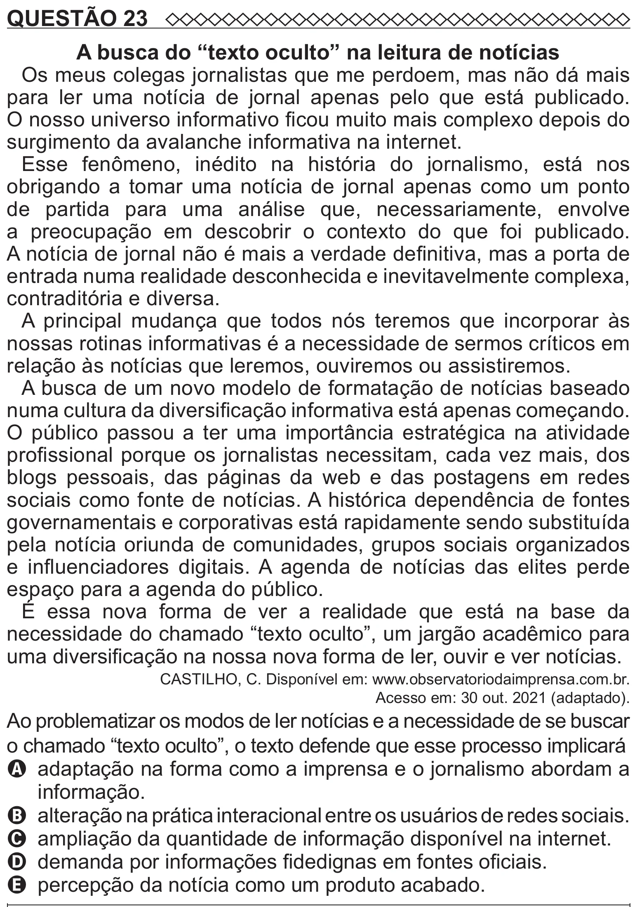

Texto extraído (pode conter ruído)

QUESTÃO 23  
A busca do “texto oculto” na leitura de notícias  
Os meus colegas jornalistas que me perdoem, mas não dá mais  
para ler uma notícia de jornal apenas pelo que está publicado.  
O nosso universo informativo ficou muito mais complexo depois do  
surgimento da avalanche informativa na internet.  
Esse fenômeno, inédito na história do jornalismo, está nos  
obrigando a tomar uma notícia de jornal apenas como um ponto  
de partida para uma análise que, necessariamente, envolve  
a preocupação em descobrir o contexto do que foi publicado.  
A notícia de jornal não é mais a verdade definitiva, mas a porta de  
entrada numa realidade desconhecida e inevitavelmente complexa,  
contraditória e diversa.  
A principal mudança que todos nós teremos que incorporar às  
nossas rotinas informativas é a necessidade de sermos críticos em  
relação às notícias que leremos, ouviremos ou assistiremos.  
A busca de um novo modelo de formatação de notícias baseado  
numa cultura da diversificação informativa está apenas começando.  
O público passou a ter uma importância estratégica na atividade  
profissional porque os jornalistas necessitam, cada vez mais, dos  
blogs pessoais, das páginas da web e das postagens em redes  
sociais como fonte de notícias. A histórica dependência de fontes  
governamentais e corporativas está rapidamente sendo substituída  
pela notícia oriunda de comunidades, grupos sociais organizados  
e influenciadores digitais. A agenda de notícias das elites perde  
espaço para a agenda do público.  
É essa nova forma de ver a realidade que está na base da  
necessidade do chamado “texto oculto”, um jargão acadêmico para  
uma diversificação na nossa nova forma de ler, ouvir e ver notícias.  
CASTILHO, C. Disponível em: www.observatoriodaimprensa.com.br.  
Acesso em: 30 out. 2021 (adaptado).  
Ao problematizar os modos de ler notícias e a necessidade de se buscar  
o chamado “texto oculto”, o texto defende que esse processo implicará  
A adaptação na forma como a imprensa e o jornalismo abordam a  
informação.  
B alteração na prática interacional entre os usuários de redes sociais.  
C ampliação da quantidade de informação disponível na internet.  
D demanda por informações fidedignas em fontes oficiais.  
E percepção da notícia como um produto acabado.

