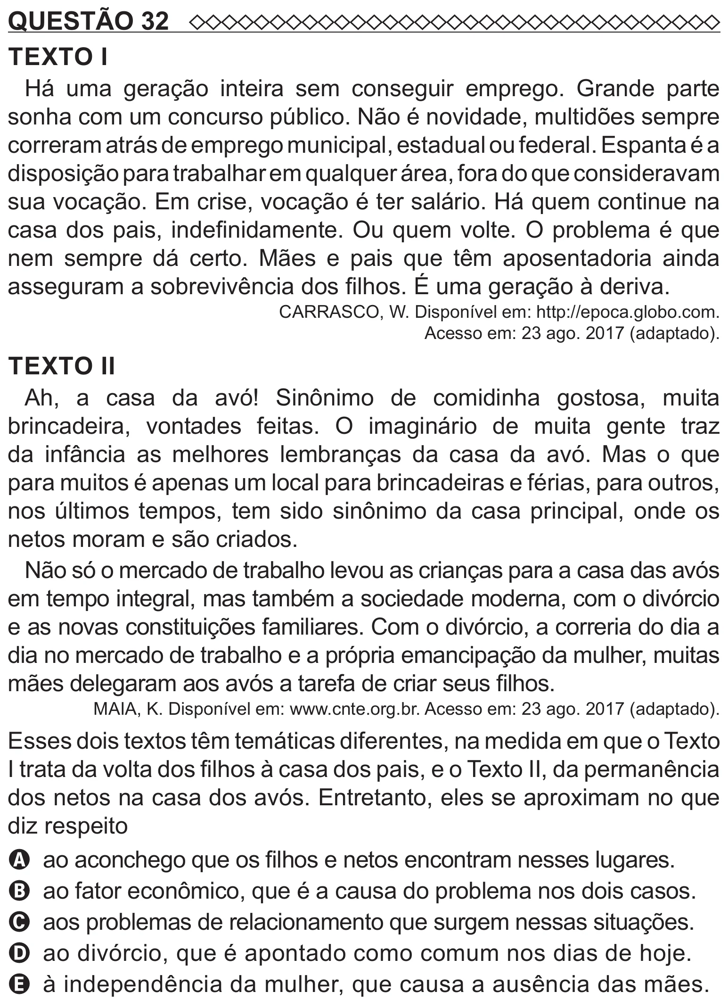

Texto extraído (pode conter ruído)

QUESTÃO 32  
TEXTO I  
Há uma geração inteira sem conseguir emprego. Grande parte  
sonha com um concurso público. Não é novidade, multidões sempre  
correram atrás de emprego municipal, estadual ou federal. Espanta é a  
disposição para trabalhar em qualquer área, fora do que consideravam  
sua vocação. Em crise, vocação é ter salário. Há quem continue na  
casa dos pais, indefinidamente. Ou quem volte. O problema é que  
nem sempre dá certo. Mães e pais que têm aposentadoria ainda  
asseguram a sobrevivência dos filhos. É uma geração à deriva.  
CARRASCO, W. Disponível em: http://epoca.globo.com.  
Acesso em: 23 ago. 2017 (adaptado).  
TEXTO II  
Ah, a casa da avó! Sinônimo de comidinha gostosa, muita  
brincadeira, vontades feitas. O imaginário de muita gente traz  
da infância as melhores lembranças da casa da avó. Mas o que  
para muitos é apenas um local para brincadeiras e férias, para outros,  
nos últimos tempos, tem sido sinônimo da casa principal, onde os  
netos moram e são criados.  
Não só o mercado de trabalho levou as crianças para a casa das avós  
em tempo integral, mas também a sociedade moderna, com o divórcio  
e as novas constituições familiares. Com o divórcio, a correria do dia a  
dia no mercado de trabalho e a própria emancipação da mulher, muitas  
mães delegaram aos avós a tarefa de criar seus filhos.  
MAIA, K. Disponível em: www.cnte.org.br. Acesso em: 23 ago. 2017 (adaptado).  
Esses dois textos têm temáticas diferentes, na medida em que o Texto  
I trata da volta dos filhos à casa dos pais, e o Texto II, da permanência  
dos netos na casa dos avós. Entretanto, eles se aproximam no que  
diz respeito  
A ao aconchego que os filhos e netos encontram nesses lugares.  
B ao fator econômico, que é a causa do problema nos dois casos.  
C aos problemas de relacionamento que surgem nessas situações.  
D ao divórcio, que é apontado como comum nos dias de hoje.  
E à independência da mulher, que causa a ausência das mães.

