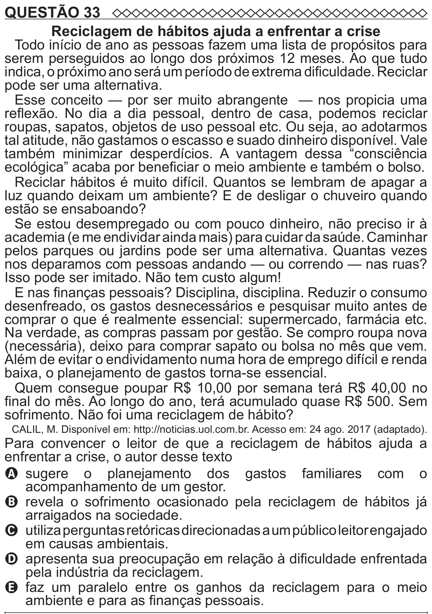

Texto extraído (pode conter ruído)

QUESTÃO 33  
Reciclagem de hábitos ajuda a enfrentar a crise  
Todo início de ano as pessoas fazem uma lista de propósitos para  
serem perseguidos ao longo dos próximos 12 meses. Ao que tudo  
indica, o próximo ano será um período de extrema dificuldade. Reciclar  
pode ser uma alternativa.  
Esse conceito — por ser muito abrangente — nos propicia uma  
reflexão. No dia a dia pessoal, dentro de casa, podemos reciclar  
roupas, sapatos, objetos de uso pessoal etc. Ou seja, ao adotarmos  
tal atitude, não gastamos o escasso e suado dinheiro disponível. Vale  
também minimizar desperdícios. A vantagem dessa “consciência  
ecológica” acaba por beneficiar o meio ambiente e também o bolso.  
Reciclar hábitos é muito difícil. Quantos se lembram de apagar a  
luz quando deixam um ambiente? E de desligar o chuveiro quando  
estão se ensaboando?  
Se estou desempregado ou com pouco dinheiro, não preciso ir à  
academia (e me endividar ainda mais) para cuidar da saúde. Caminhar  
pelos parques ou jardins pode ser uma alternativa. Quantas vezes  
nos deparamos com pessoas andando — ou correndo — nas ruas?  
Isso pode ser imitado. Não tem custo algum!  
E nas finanças pessoais? Disciplina, disciplina. Reduzir o consumo  
desenfreado, os gastos desnecessários e pesquisar muito antes de  
comprar o que é realmente essencial: supermercado, farmácia etc.  
Na verdade, as compras passam por gestão. Se compro roupa nova  
(necessária), deixo para comprar sapato ou bolsa no mês que vem.  
Além de evitar o endividamento numa hora de emprego difícil e renda  
baixa, o planejamento de gastos torna-se essencial.  
Quem consegue poupar R$ 10,00 por semana terá R$ 40,00 no  
final do mês. Ao longo do ano, terá acumulado quase R$ 500. Sem  
sofrimento. Não foi uma reciclagem de hábito?  
CALIL, M. Disponível em: http://noticias.uol.com.br. Acesso em: 24 ago. 2017 (adaptado).  
Para convencer o leitor de que a reciclagem de hábitos ajuda a  
enfrentar a crise, o autor desse texto  
A   
sugere o planejamento dos gastos familiares com o  
acompanhamento de um gestor.  
B revela o sofrimento ocasionado pela reciclagem de hábitos já  
arraigados na sociedade.  
C utiliza perguntas retóricas direcionadas a um público leitor engajado  
em causas ambientais.  
D apresenta sua preocupação em relação à dificuldade enfrentada  
pela indústria da reciclagem.  
E   
faz um paralelo entre os ganhos da reciclagem para o meio  
ambiente e para as finanças pessoais.

