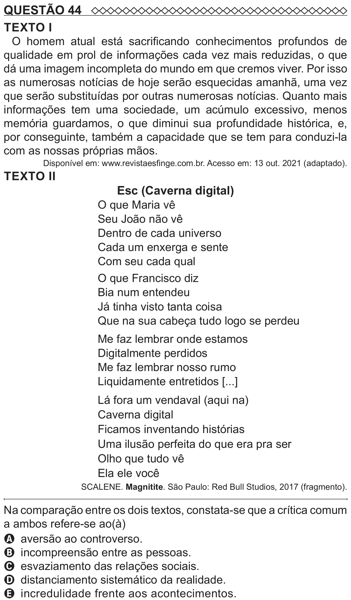

Texto extraído (pode conter ruído)

QUESTÃO 44  
TEXTO I  
O homem atual está sacrificando conhecimentos profundos de  
qualidade em prol de informações cada vez mais reduzidas, o que  
dá uma imagem incompleta do mundo em que cremos viver. Por isso  
as numerosas notícias de hoje serão esquecidas amanhã, uma vez  
que serão substituídas por outras numerosas notícias. Quanto mais  
informações tem uma sociedade, um acúmulo excessivo, menos  
memória guardamos, o que diminui sua profundidade histórica, e,  
por conseguinte, também a capacidade que se tem para conduzi-la  
com as nossas próprias mãos.  
Disponível em: www.revistaesfinge.com.br. Acesso em: 13 out. 2021 (adaptado).  
TEXTO II  
Esc (Caverna digital)  
O que Maria vê  
Seu João não vê  
Dentro de cada universo  
Cada um enxerga e sente  
Com seu cada qual  
O que Francisco diz  
Bia num entendeu  
Já tinha visto tanta coisa  
Que na sua cabeça tudo logo se perdeu  
Me faz lembrar onde estamos  
Digitalmente perdidos  
Me faz lembrar nosso rumo  
Liquidamente entretidos [...]  
Lá fora um vendaval (aqui na)  
Caverna digital  
Ficamos inventando histórias  
Uma ilusão perfeita do que era pra ser  
Olho que tudo vê  
Ela ele você  
SCALENE. Magnitite. São Paulo: Red Bull Studios, 2017 (fragmento).  
Na comparação entre os dois textos, constata-se que a crítica comum  
a ambos refere-se ao(à)  
A aversão ao controverso.  
B incompreensão entre as pessoas.  
C esvaziamento das relações sociais.  
D distanciamento sistemático da realidade.

