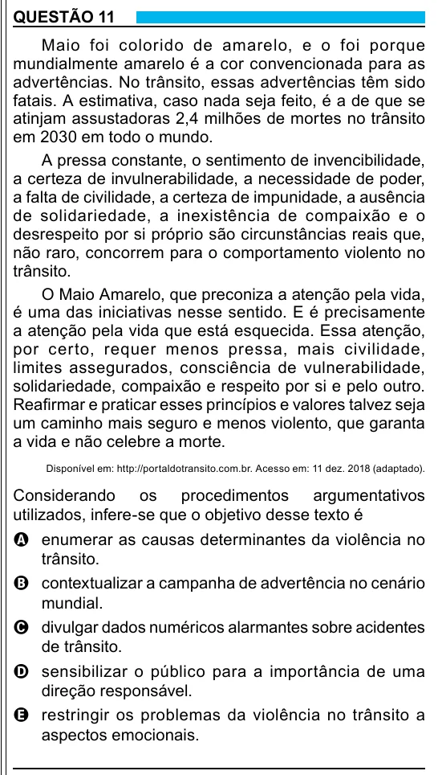

Texto extraído (pode conter ruído)

QUESTÃO 11  
Maio foi colorido de amarelo, e o foi porque  
mundialmente amarelo é a cor convencionada para as  
advertências. No trânsito, essas advertências têm sido  
fatais. A estimativa, caso nada seja feito, é a de que se  
atinjam assustadoras 2,4 milhões de mortes no trânsito  
em 2030 em todo o mundo.  
A pressa constante, o sentimento de invencibilidade,  
a certeza de invulnerabilidade, a necessidade de poder,  
a falta de civilidade, a certeza de impunidade, a ausência  
de solidariedade, a inexistência de compaixão e o  
desrespeito por si próprio são circunstâncias reais que,  
não raro, concorrem para o comportamento violento no  
trânsito.  
O Maio Amarelo, que preconiza a atenção pela vida,  
é uma das iniciativas nesse sentido. E é precisamente  
a atenção pela vida que está esquecida. Essa atenção,  
por certo, requer menos pressa, mais civilidade,  
limites assegurados, consciência de vulnerabilidade,  
solidariedade, compaixão e respeito por si e pelo outro.  
Reafirmar e praticar esses princípios e valores talvez seja  
um caminho mais seguro e menos violento, que garanta  
a vida e não celebre a morte.  
Disponível em: http://portaldotransito.com.br. Acesso em: 11 dez. 2018 (adaptado).  
Considerando os procedimentos argumentativos  
utilizados, infere-se que o objetivo desse texto é  
A enumerar as causas determinantes da violência no  
trânsito.  
B contextualizar a campanha de advertência no cenário  
mundial.  
C divulgar dados numéricos alarmantes sobre acidentes  
de trânsito.  
D sensibilizar o público para a importância de uma  
direção responsável.  
E restringir os problemas da violência no trânsito a  
aspectos emocionais.  
7

