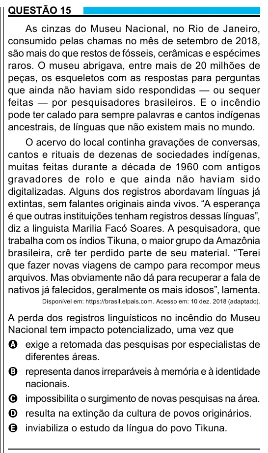

Texto extraído (pode conter ruído)

QUESTÃO 15  
As cinzas do Museu Nacional, no Rio de Janeiro,  
consumido pelas chamas no mês de setembro de 2018,  
são mais do que restos de fósseis, cerâmicas e espécimes  
raros. O museu abrigava, entre mais de 20 milhões de  
peças, os esqueletos com as respostas para perguntas  
que ainda não haviam sido respondidas — ou sequer  
feitas — por pesquisadores brasileiros. E o incêndio  
pode ter calado para sempre palavras e cantos indígenas  
ancestrais, de línguas que não existem mais no mundo.  
O acervo do local continha gravações de conversas,  
cantos e rituais de dezenas de sociedades indígenas,  
muitas feitas durante a década de 1960 com antigos  
gravadores de rolo e que ainda não haviam sido  
digitalizadas. Alguns dos registros abordavam línguas já  
extintas, sem falantes originais ainda vivos. “A esperança  
é que outras instituições tenham registros dessas línguas”,  
diz a linguista Marilia Facó Soares. A pesquisadora, que  
trabalha com os índios Tikuna, o maior grupo da Amazônia  
brasileira, crê ter perdido parte de seu material. “Terei  
que fazer novas viagens de campo para recompor meus  
arquivos. Mas obviamente não dá para recuperar a fala de  
nativos já falecidos, geralmente os mais idosos”, lamenta.  
Disponível em: https://brasil.elpais.com. Acesso em: 10 dez. 2018 (adaptado).  
A perda dos registros linguísticos no incêndio do Museu  
Nacional tem impacto potencializado, uma vez que  
A exige a retomada das pesquisas por especialistas de  
diferentes áreas.  
B representa danos irreparáveis à memória e à identidade  
nacionais.  
C impossibilita o surgimento de novas pesquisas na área.  
D resulta na extinção da cultura de povos originários.  
E inviabiliza o estudo da língua do povo Tikuna.  
9

