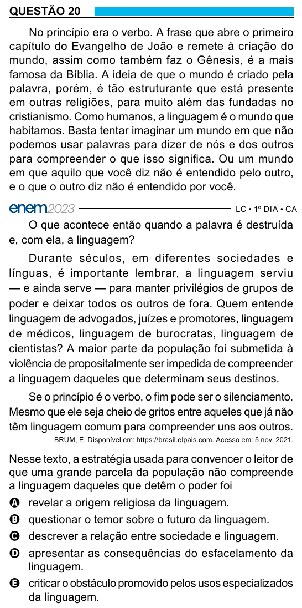

Texto extraído (pode conter ruído)

QUESTÃO 20  
No princípio era o verbo. A frase que abre o primeiro  
capítulo do Evangelho de João e remete à criação do  
mundo, assim como também faz o Gênesis, é a mais  
famosa da Bíblia. A ideia de que o mundo é criado pela  
palavra, porém, é tão estruturante que está presente  
em outras religiões, para muito além das fundadas no  
cristianismo. Como humanos, a linguagem é o mundo que  
habitamos. Basta tentar imaginar um mundo em que não  
podemos usar palavras para dizer de nós e dos outros  
para compreender o que isso significa. Ou um mundo  
em que aquilo que você diz não é entendido pelo outro,  
e o que o outro diz não é entendido por você.  
O que acontece então quando a palavra é destruída  
e, com ela, a linguagem?  
Durante séculos, em diferentes sociedades e  
línguas, é importante lembrar, a linguagem serviu  
— e ainda serve — para manter privilégios de grupos de  
poder e deixar todos os outros de fora. Quem entende  
linguagem de advogados, juízes e promotores, linguagem  
de médicos, linguagem de burocratas, linguagem de  
cientistas? A maior parte da população foi submetida à  
violência de propositalmente ser impedida de compreender  
a linguagem daqueles que determinam seus destinos.  
Se o princípio é o verbo, o fim pode ser o silenciamento.  
Mesmo que ele seja cheio de gritos entre aqueles que já não  
têm linguagem comum para compreender uns aos outros.  
BRUM, E. Disponível em: https://brasil.elpais.com. Acesso em: 5 nov. 2021.  
Nesse texto, a estratégia usada para convencer o leitor de  
que uma grande parcela da população não compreende  
a linguagem daqueles que detêm o poder foi  
A revelar a origem religiosa da linguagem.  
B questionar o temor sobre o futuro da linguagem.  
C descrever a relação entre sociedade e linguagem.  
D apresentar as consequências do esfacelamento da  
linguagem.  
E criticar o obstáculo promovido pelos usos especializados  
da linguagem.

