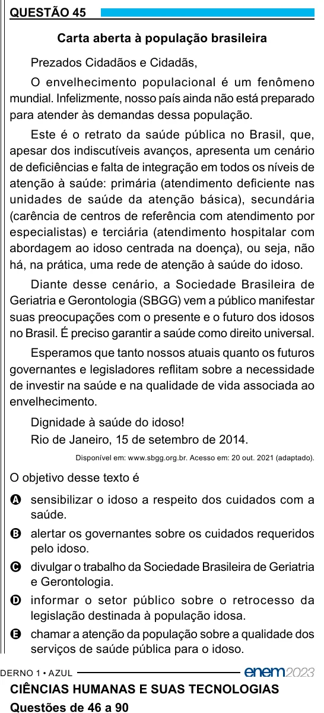

Texto extraído (pode conter ruído)

QUESTÃO 45  
Carta aberta à população brasileira  
Prezados Cidadãos e Cidadãs,  
O envelhecimento populacional é um fenômeno  
mundial. Infelizmente, nosso país ainda não está preparado  
para atender às demandas dessa população.  
Este é o retrato da saúde pública no Brasil, que,  
apesar dos indiscutíveis avanços, apresenta um cenário  
de deficiências e falta de integração em todos os níveis de  
atenção à saúde: primária (atendimento deficiente nas  
unidades de saúde da atenção básica), secundária  
(carência de centros de referência com atendimento por  
especialistas) e terciária (atendimento hospitalar com  
abordagem ao idoso centrada na doença), ou seja, não  
há, na prática, uma rede de atenção à saúde do idoso.  
Diante desse cenário, a Sociedade Brasileira de  
Geriatria e Gerontologia (SBGG) vem a público manifestar  
suas preocupações com o presente e o futuro dos idosos  
no Brasil. É preciso garantir a saúde como direito universal.  
Esperamos que tanto nossos atuais quanto os futuros  
governantes e legisladores reflitam sobre a necessidade  
de investir na saúde e na qualidade de vida associada ao  
envelhecimento.  
Dignidade à saúde do idoso!  
Rio de Janeiro, 15 de setembro de 2014.  
Disponível em: www.sbgg.org.br. Acesso em: 20 out. 2021 (adaptado).  
O objetivo desse texto é  
A sensibilizar o idoso a respeito dos cuidados com a  
saúde.  
B alertar os governantes sobre os cuidados requeridos  
pelo idoso.  
C divulgar o trabalho da Sociedade Brasileira de Geriatria  
e Gerontologia.  
D informar o setor público sobre o retrocesso da  
legislação destinada à população idosa.  
E chamar a atenção da população sobre a qualidade dos  
serviços de saúde pública para o idoso.  
CIÊNCIAS HUMANAS E SUAS TECNOLOGIAS

