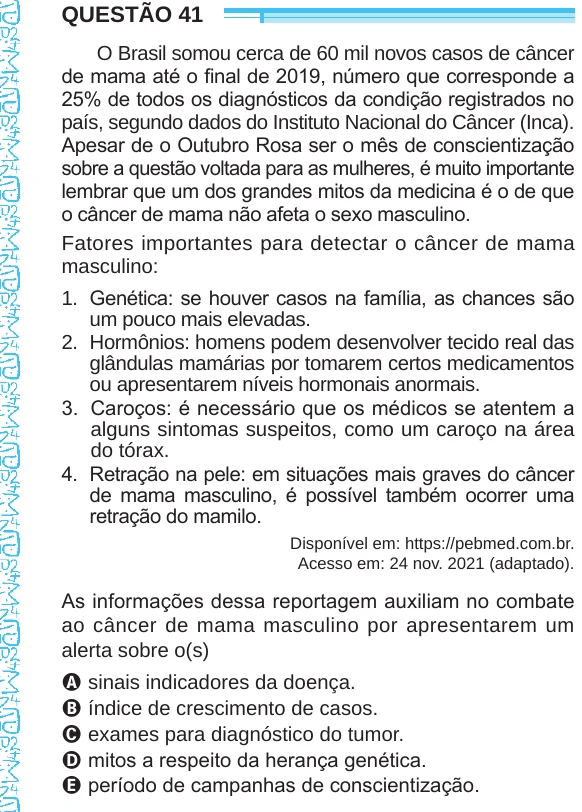

Texto extraído (pode conter ruído)

QUESTÃO 41  
O Brasil somou cerca de 60 mil novos casos de câncer  
de mama até o final de 2019, número que corresponde a  
25% de todos os diagnósticos da condição registrados no  
país, segundo dados do Instituto Nacional do Câncer (Inca).  
Apesar de o Outubro Rosa ser o mês de conscientização  
sobre a questão voltada para as mulheres, é muito importante  
lembrar que um dos grandes mitos da medicina é o de que  
o câncer de mama não afeta o sexo masculino.  
Fatores importantes para detectar o câncer de mama  
masculino:  
1.	   Genética: se houver casos na família, as chances são  
um pouco mais elevadas.  
2.	  Hormônios: homens podem desenvolver tecido real das  
glândulas mamárias por tomarem certos medicamentos  
ou apresentarem níveis hormonais anormais.  
3.	  Caroços: é necessário que os médicos se atentem a  
alguns sintomas suspeitos, como um caroço na área  
do tórax.  
4.	  Retração na pele: em situações mais graves do câncer  
de mama masculino, é possível também ocorrer uma  
retração do mamilo.  
Disponível em: https://pebmed.com.br.  
Acesso em: 24 nov. 2021 (adaptado).  
As informações dessa reportagem auxiliam no combate  
ao câncer de mama masculino por apresentarem um  
alerta sobre o(s)  
A sinais indicadores da doença.  
B índice de crescimento de casos.  
C exames para diagnóstico do tumor.  
D mitos a respeito da herança genética.  
E período de campanhas de conscientização.

