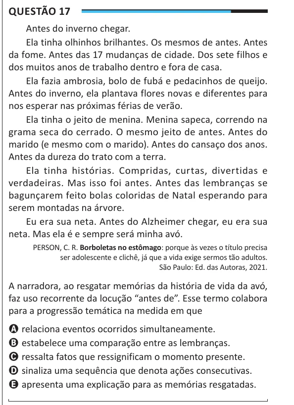

Texto extraído (pode conter ruído)

Questão 17  
Antes do inverno chegar.  
Ela tinha olhinhos brilhantes. Os mesmos de antes. Antes  
da fome. Antes das 17 mudanças de cidade. Dos sete filhos e  
dos muitos anos de trabalho dentro e fora de casa.  
Ela fazia ambrosia, bolo de fubá e pedacinhos de queijo.  
Antes do inverno, ela plantava flores novas e diferentes para  
nos esperar nas próximas férias de verão.  
Ela tinha o jeito de menina. Menina sapeca, correndo na  
grama seca do cerrado. O mesmo jeito de antes. Antes do  
marido (e mesmo com o marido). Antes do cansaço dos anos.  
Antes da dureza do trato com a terra.  
Ela tinha histórias. Compridas, curtas, divertidas e  
verdadeiras. Mas isso foi antes. Antes das lembranças se  
bagunçarem feito bolas coloridas de Natal esperando para  
serem montadas na árvore.  
Eu era sua neta. Antes do Alzheimer chegar, eu era sua  
neta. Mas ela é e sempre será minha avó.  
PERSON, C. R. Borboletas no estômago: porque às vezes o título precisa  
ser adolescente e clichê, já que a vida exige sermos tão adultos.  
São Paulo: Ed. das Autoras, 2021.  
A narradora, ao resgatar memórias da história de vida da avó,  
faz uso recorrente da locução “antes de”. Esse termo colabora  
para a progressão temática na medida em que  
A relaciona eventos ocorridos simultaneamente.  
B estabelece uma comparação entre as lembranças.  
C ressalta fatos que ressignificam o momento presente.  
D sinaliza uma sequência que denota ações consecutivas.  
E apresenta uma explicação para as memórias resgatadas.

