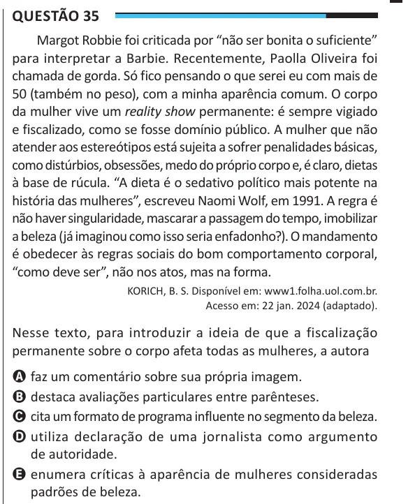

Texto extraído (pode conter ruído)

Questão 35  
Margot Robbie foi criticada por “não ser bonita o suficiente”  
para interpretar a Barbie. Recentemente, Paolla Oliveira foi  
chamada de gorda. Só fico pensando o que serei eu com mais de  
50 (também no peso), com a minha aparência comum. O corpo  
da mulher vive um reality show permanente: é sempre vigiado  
e fiscalizado, como se fosse domínio público. A mulher que não  
atender aos estereótipos está sujeita a sofrer penalidades básicas,  
como distúrbios, obsessões, medo do próprio corpo e, é claro, dietas  
à base de rúcula. “A dieta é o sedativo político mais potente na  
história das mulheres”, escreveu Naomi Wolf, em 1991. A regra é  
não haver singularidade, mascarar a passagem do tempo, imobilizar  
a beleza (já imaginou como isso seria enfadonho?). O mandamento  
é obedecer às regras sociais do bom comportamento corporal,  
“como deve ser”, não nos atos, mas na forma.  
KORICH, B. S. Disponível em: www1.folha.uol.com.br.  
Acesso em: 22 jan. 2024 (adaptado).  
Nesse texto, para introduzir a ideia de que a fiscalização  
permanente sobre o corpo afeta todas as mulheres, a autora  
A faz um comentário sobre sua própria imagem.  
B destaca avaliações particulares entre parênteses.  
C cita um formato de programa influente no segmento da beleza.  
D utiliza declaração de uma jornalista como argumento  
de autoridade.  
E enumera críticas à aparência de mulheres consideradas  
padrões de beleza.

