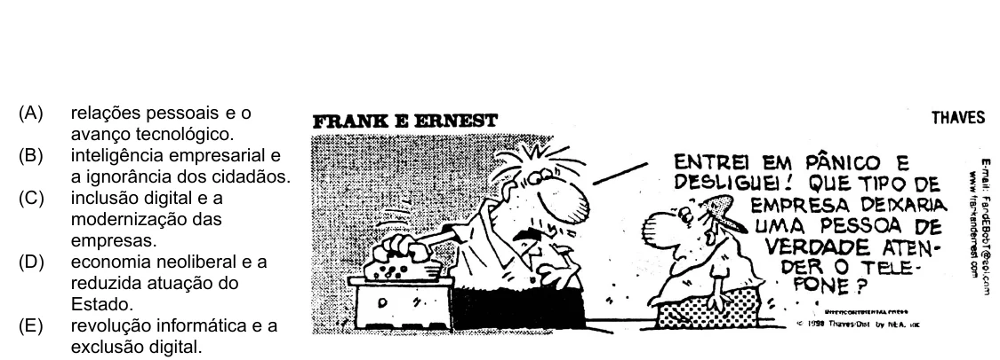

Texto extraído (pode conter ruído)

(A)  
relações pessoais e o  
avanço tecnológico.  
(B)  
inteligência empresarial e  
a ignorância dos cidadãos.  
(C)  
inclusão digital e a  
modernização das  
empresas.  
(D)  
economia neoliberal e a  
reduzida atuação do  
Estado.  
(E)  
revolução informática e a  
exclusão digital.

