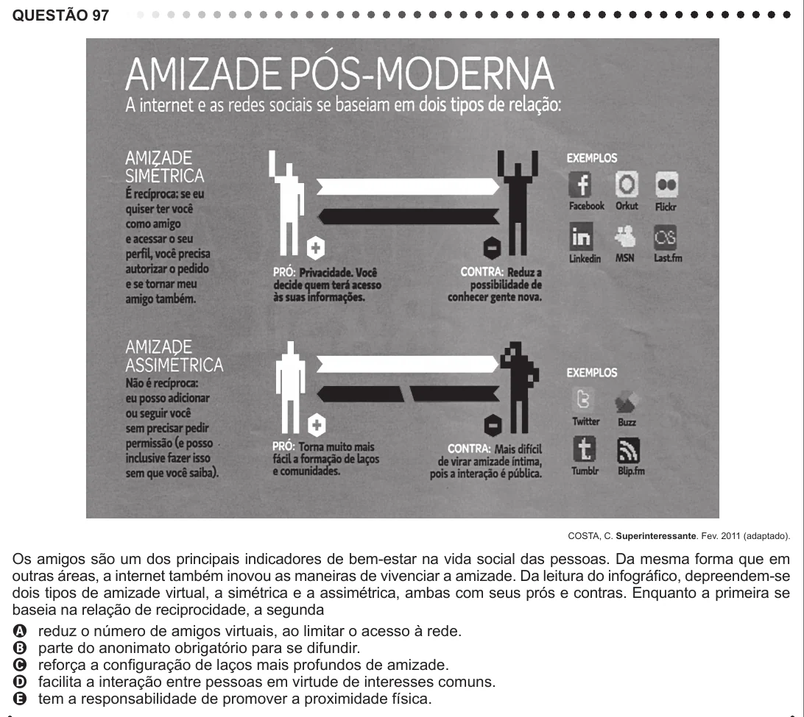

Texto extraído (pode conter ruído)

QUESTÃO 97  
COSTA, C. Superinteressante. Fev. 2011 (adaptado).  
Os amigos são um dos principais indicadores de bem-estar na vida social das pessoas. Da mesma forma que em  
outras áreas, a internet também inovou as maneiras de vivenciar a amizade. Da leitura do infográfico, depreendem-se  
dois tipos de amizade virtual, a simétrica e a assimétrica, ambas com seus prós e contras. Enquanto a primeira se  
baseia na relação de reciprocidade, a segunda  
A reduz o número de amigos virtuais, ao limitar o acesso à rede.  
B parte do anonimato obrigatório para se difundir.  
C reforça a configuração de laços mais profundos de amizade.  
D facilita a interação entre pessoas em virtude de interesses comuns.  
E tem a responsabilidade de promover a proximidade física.

