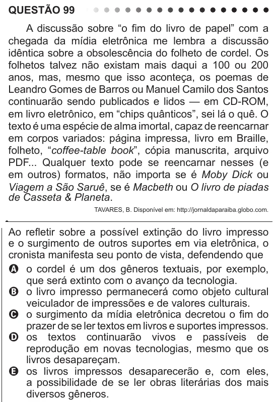

Texto extraído (pode conter ruído)

QUESTÃO 99  
A discussão sobre “o fim do livro de papel” com a  
chegada da mídia eletrônica me lembra a discussão  
idêntica sobre a obsolescência do folheto de cordel. Os  
folhetos talvez não existam mais daqui a 100 ou 200  
anos, mas, mesmo que isso aconteça, os poemas de  
Leandro Gomes de Barros ou Manuel Camilo dos Santos  
continuarão sendo publicados e lidos — em CD-ROM,  
em livro eletrônico, em “chips quânticos”, sei lá o quê. O  
texto é uma espécie de alma imortal, capaz de reencarnar  
em corpos variados: página impressa, livro em Braille,  
folheto, “coffee-table book”, cópia manuscrita, arquivo  
PDF... Qualquer texto pode se reencarnar nesses (e  
em outros) formatos, não importa se é Moby Dick ou  
Viagem a São Saruê, se é Macbeth ou O livro de piadas  
de Casseta & Planeta.  
TAVARES, B. Disponível em: http://jornaldaparaiba.globo.com.  
Ao refletir sobre a possível extinção do livro impresso  
e o surgimento de outros suportes em via eletrônica, o  
cronista manifesta seu ponto de vista, defendendo que  
A o cordel é um dos gêneros textuais, por exemplo,  
que será extinto com o avanço da tecnologia.  
B o livro impresso permanecerá como objeto cultural  
veiculador de impressões e de valores culturais.  
C o surgimento da mídia eletrônica decretou o fim do  
prazer de se ler textos em livros e suportes impressos.  
D os textos continuarão vivos e passíveis de  
reprodução em novas tecnologias, mesmo que os  
livros desapareçam.  
E os livros impressos desaparecerão e, com eles,  
a possibilidade de se ler obras literárias dos mais  
diversos gêneros.

