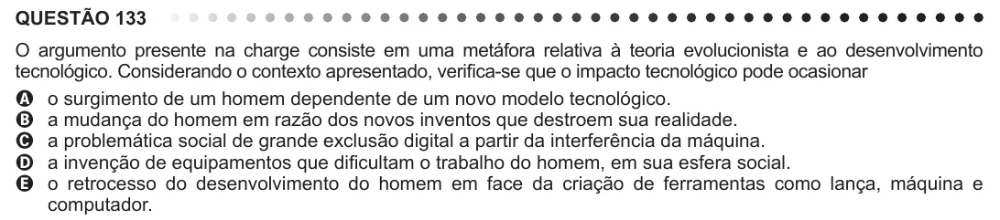

Texto extraído (pode conter ruído)

QUESTÃO 133  
O argumento presente na charge consiste em uma metáfora relativa à teoria evolucionista e ao desenvolvimento  
tecnológico. Considerando o contexto apresentado, verifica-se que o impacto tecnológico pode ocasionar  
A o surgimento de um homem dependente de um novo modelo tecnológico.  
B a mudança do homem em razão dos novos inventos que destroem sua realidade.  
C a problemática social de grande exclusão digital a partir da interferência da máquina.  
D a invenção de equipamentos que dificultam o trabalho do homem, em sua esfera social.  
E o retrocesso do desenvolvimento do homem em face da criação de ferramentas como lança, máquina e  
computador.

