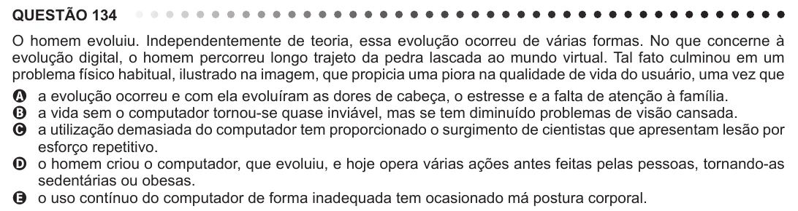

Texto extraído (pode conter ruído)

QUESTÃO 134  
O homem evoluiu. Independentemente de teoria, essa evolução ocorreu de várias formas. No que concerne à  
evolução digital, o homem percorreu longo trajeto da pedra lascada ao mundo virtual. Tal fato culminou em um  
problema físico habitual, ilustrado na imagem, que propicia uma piora na qualidade de vida do usuário, uma vez que  
A a evolução ocorreu e com ela evoluíram as dores de cabeça, o estresse e a falta de atenção à família.  
B a vida sem o computador tornou-se quase inviável, mas se tem diminuído problemas de visão cansada.  
C a utilização demasiada do computador tem proporcionado o surgimento de cientistas que apresentam lesão por  
esforço repetitivo.  
D o homem criou o computador, que evoluiu, e hoje opera várias ações antes feitas pelas pessoas, tornando-as  
sedentárias ou obesas.  
E o uso contínuo do computador de forma inadequada tem ocasionado má postura corporal.

