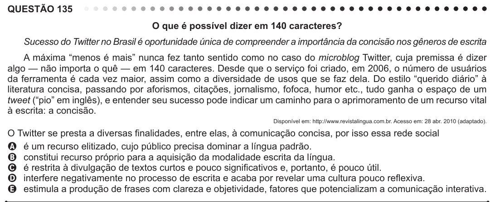

Texto extraído (pode conter ruído)

QUESTÃO 135  
O que é possível dizer em 140 caracteres?  
Sucesso do Twitter no Brasil é oportunidade única de compreender a importância da concisão nos gêneros de escrita  
A máxima “menos é mais” nunca fez tanto sentido como no caso do microblog Twitter, cuja premissa é dizer  
algo — não importa o quê — em 140 caracteres. Desde que o serviço foi criado, em 2006, o número de usuários  
da ferramenta é cada vez maior, assim como a diversidade de usos que se faz dela. Do estilo “querido diário” à  
literatura concisa, passando por aforismos, citações, jornalismo, fofoca, humor etc., tudo ganha o espaço de um  
tweet (“pio” em inglês), e entender seu sucesso pode indicar um caminho para o aprimoramento de um recurso vital  
à escrita: a concisão.  
Disponível em: http://www.revistalingua.com.br. Acesso em: 28 abr. 2010 (adaptado).  
O Twitter se presta a diversas finalidades, entre elas, à comunicação concisa, por isso essa rede social  
A é um recurso elitizado, cujo público precisa dominar a língua padrão.  
B constitui recurso próprio para a aquisição da modalidade escrita da língua.  
C é restrita à divulgação de textos curtos e pouco significativos e, portanto, é pouco útil.  
D interfere negativamente no processo de escrita e acaba por revelar uma cultura pouco reflexiva.  
E estimula a produção de frases com clareza e objetividade, fatores que potencializam a comunicação interativa.

