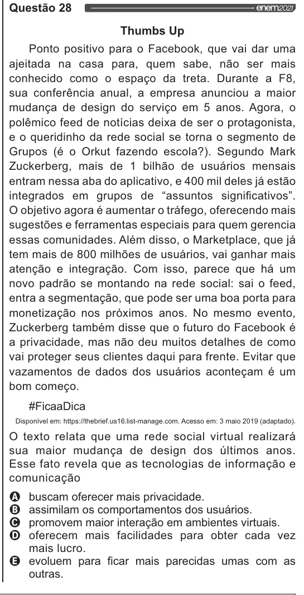

Texto extraído (pode conter ruído)

Questão 28  
Thumbs Up  
Ponto positivo para o Facebook, que vai dar uma  
ajeitada na casa para, quem sabe, não ser mais  
conhecido como o espaço da treta. Durante a F8,  
sua conferência anual, a empresa anunciou a maior  
mudança de design do serviço em 5 anos. Agora, o  
polêmico feed de notícias deixa de ser o protagonista,  
e o queridinho da rede social se torna o segmento de  
Grupos (é o Orkut fazendo escola?). Segundo Mark  
Zuckerberg, mais de 1 bilhão de usuários mensais  
entram nessa aba do aplicativo, e 400 mil deles já estão  
integrados em grupos de “assuntos significativos”.  
O objetivo agora é aumentar o tráfego, oferecendo mais  
sugestões e ferramentas especiais para quem gerencia  
essas comunidades. Além disso, o Marketplace, que já  
tem mais de 800 milhões de usuários, vai ganhar mais  
atenção e integração. Com isso, parece que há um  
novo padrão se montando na rede social: sai o feed,  
entra a segmentação, que pode ser uma boa porta para  
monetização nos próximos anos. No mesmo evento,  
Zuckerberg também disse que o futuro do Facebook é  
a privacidade, mas não deu muitos detalhes de como  
vai proteger seus clientes daqui para frente. Evitar que  
vazamentos de dados dos usuários aconteçam é um  
bom começo.  
HFicaaDica  
Disponível em: https:/lthebrief.us 16 listmanage.com. Acesso em: 3 maio 2019 (adaptado).  
O texto relata que uma rede social virtual realizará  
sua maior mudança de design dos últimos anos.  
Esse fato revela que as tecnologias de informação e  
comunicação  
OVO O  
buscam oferecer mais privacidade.  
assimilam os comportamentos dos usuários.  
promovem maior interação em ambientes virtuais.  
oferecem mais facilidades para obter cada vez  
mais lucro.  
evoluem para ficar mais parecidas umas com as  
outras.

