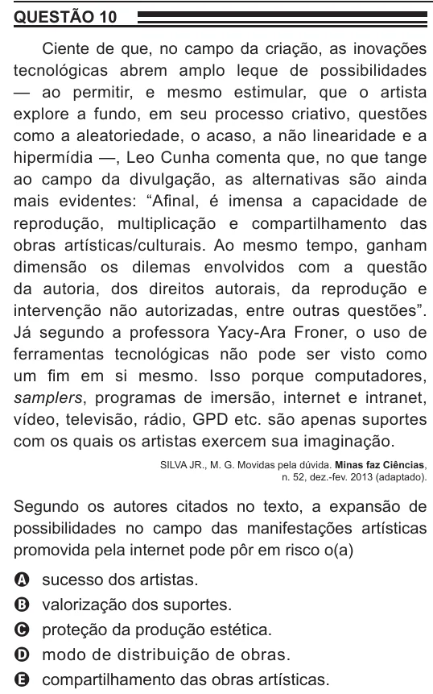

Texto extraído (pode conter ruído)

QUESTÃO 10  
Ciente de que, no campo da criação, as inovações  
tecnológicas abrem amplo leque de possibilidades  
— ao permitir, e mesmo estimular, que o artista  
explore a fundo, em seu processo criativo, questões  
como a aleatoriedade, o acaso, a não linearidade e a  
hipermídia —, Leo Cunha comenta que, no que tange  
ao campo da divulgação, as alternativas são ainda  
mais evidentes: “Afinal, é imensa a capacidade de  
reprodução, multiplicação e compartilhamento das  
obras artísticas/culturais. Ao mesmo tempo, ganham  
dimensão os dilemas envolvidos com a questão  
da autoria, dos direitos autorais, da reprodução e  
intervenção não autorizadas, entre outras questões”.  
Já segundo a professora Yacy-Ara Froner, o uso de  
ferramentas tecnológicas não pode ser visto como  
um fim em si mesmo. Isso porque computadores,  
samplers, programas de imersão, internet e intranet,  
vídeo, televisão, rádio, GPD etc. são apenas suportes  
com os quais os artistas exercem sua imaginação.  
SILVA JR., M. G. Movidas pela dúvida. Minas faz Ciências,  
n. 52, dez.-fev. 2013 (adaptado).  
Segundo os autores citados no texto, a expansão de  
possibilidades no campo das manifestações artísticas  
promovida pela internet pode pôr em risco o(a)  
sucesso dos artistas.  
A  
valorização dos suportes.  
B  
proteção da produção estética.  
C  
modo de distribuição de obras.  
D  
compartilhamento das obras artísticas.  
E

