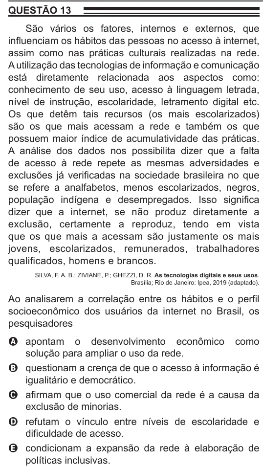

Texto extraído (pode conter ruído)

QUESTÃO 13  
São vários os fatores, internos e externos, que  
influenciam os hábitos das pessoas no acesso à internet,  
assim como nas práticas culturais realizadas na rede.  
A utilização das tecnologias de informação e comunicação  
está diretamente relacionada aos aspectos como:  
conhecimento de seu uso, acesso à linguagem letrada,  
nível de instrução, escolaridade, letramento digital etc.  
Os que detêm tais recursos (os mais escolarizados)  
são os que mais acessam a rede e também os que  
possuem maior índice de acumulatividade das práticas.  
A análise dos dados nos possibilita dizer que a falta  
de acesso à rede repete as mesmas adversidades e  
exclusões já verificadas na sociedade brasileira no que  
se refere a analfabetos, menos escolarizados, negros,  
população indígena e desempregados. Isso significa  
dizer que a internet, se não produz diretamente a  
exclusão, certamente a reproduz, tendo em vista  
que os que mais a acessam são justamente os mais  
jovens, escolarizados, remunerados, trabalhadores  
qualificados, homens e brancos.  
SILVA, F. A. B.; ZIVIANE, P.; GHEZZI, D. R. As tecnologias digitais e seus usos.  
Brasília; Rio de Janeiro: Ipea, 2019 (adaptado).  
Ao analisarem a correlação entre os hábitos e o perfil  
socioeconômico dos usuários da internet no Brasil, os  
pesquisadores  
A apontam o desenvolvimento econômico como  
solução para ampliar o uso da rede.  
B questionam a crença de que o acesso à informação é  
igualitário e democrático.  
C afirmam que o uso comercial da rede é a causa da  
exclusão de minorias.  
D refutam o vínculo entre níveis de escolaridade e  
dificuldade de acesso.  
E condicionam a expansão da rede à elaboração de  
políticas inclusivas.

