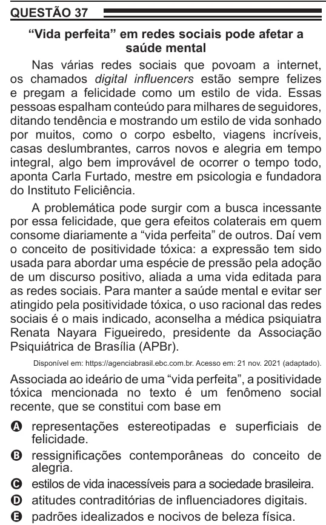

Texto extraído (pode conter ruído)

QUESTÃO 37  
“Vida perfeita” em redes sociais pode afetar a  
saúde mental  
Nas várias redes sociais que povoam a internet,  
os chamados digital influencers estão sempre felizes  
e pregam a felicidade como um estilo de vida. Essas  
pessoas espalham conteúdo para milhares de seguidores,  
ditando tendência e mostrando um estilo de vida sonhado  
por muitos, como o corpo esbelto, viagens incríveis,  
casas deslumbrantes, carros novos e alegria em tempo  
integral, algo bem improvável de ocorrer o tempo todo,  
aponta Carla Furtado, mestre em psicologia e fundadora  
do Instituto Feliciência.  
A problemática pode surgir com a busca incessante  
por essa felicidade, que gera efeitos colaterais em quem  
consome diariamente a “vida perfeita” de outros. Daí vem  
o conceito de positividade tóxica: a expressão tem sido  
usada para abordar uma espécie de pressão pela adoção  
de um discurso positivo, aliada a uma vida editada para  
as redes sociais. Para manter a saúde mental e evitar ser  
atingido pela positividade tóxica, o uso racional das redes  
sociais é o mais indicado, aconselha a médica psiquiatra  
Renata Nayara Figueiredo, presidente da Associação  
Psiquiátrica de Brasília (APBr).  
Disponível em: https://agenciabrasil.ebc.com.br. Acesso em: 21 nov. 2021 (adaptado).  
Associada ao ideário de uma “vida perfeita”, a positividade  
tóxica mencionada no texto é um fenômeno social  
recente, que se constitui com base em  
A representações estereotipadas e superficiais de  
felicidade.  
B ressignificações contemporâneas do conceito de  
alegria.  
C estilos de vida inacessíveis para a sociedade brasileira.  
D atitudes contraditórias de influenciadores digitais.  
E padrões idealizados e nocivos de beleza física.

