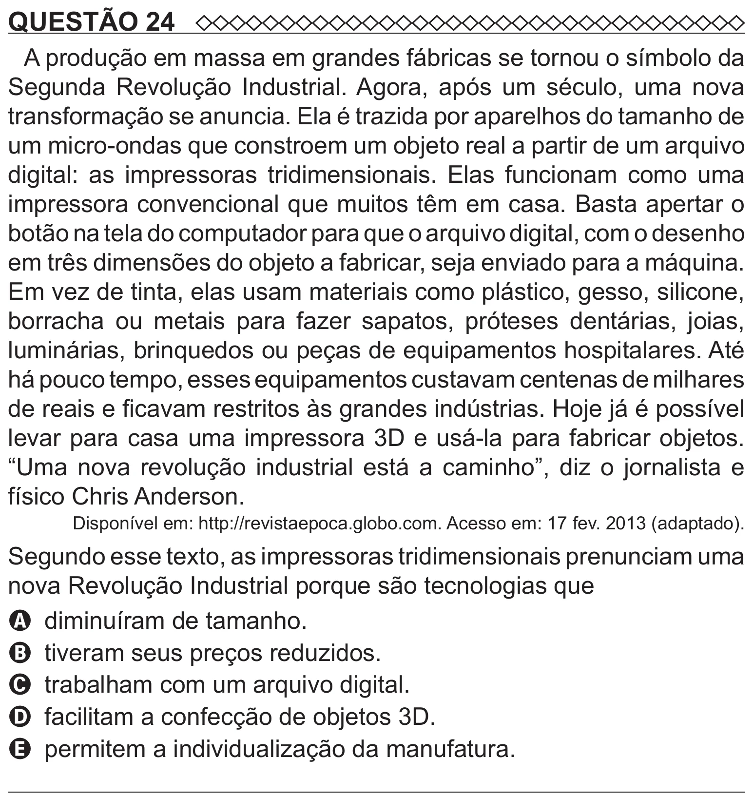

Texto extraído (pode conter ruído)

QUESTÃO 24  
A produção em massa em grandes fábricas se tornou o símbolo da  
Segunda Revolução Industrial. Agora, após um século, uma nova  
transformação se anuncia. Ela é trazida por aparelhos do tamanho de  
um micro-ondas que constroem um objeto real a partir de um arquivo  
digital: as impressoras tridimensionais. Elas funcionam como uma  
impressora convencional que muitos têm em casa. Basta apertar o  
botão na tela do computador para que o arquivo digital, com o desenho  
em três dimensões do objeto a fabricar, seja enviado para a máquina.  
Em vez de tinta, elas usam materiais como plástico, gesso, silicone,  
borracha ou metais para fazer sapatos, próteses dentárias, joias,  
luminárias, brinquedos ou peças de equipamentos hospitalares. Até  
há pouco tempo, esses equipamentos custavam centenas de milhares  
de reais e ficavam restritos às grandes indústrias. Hoje já é possível  
levar para casa uma impressora 3D e usá-la para fabricar objetos.  
“Uma nova revolução industrial está a caminho”, diz o jornalista e  
físico Chris Anderson.  
Disponível em: http://revistaepoca.globo.com. Acesso em: 17 fev. 2013 (adaptado).  
Segundo esse texto, as impressoras tridimensionais prenunciam uma  
nova Revolução Industrial porque são tecnologias que  
A diminuíram de tamanho.  
B tiveram seus preços reduzidos.  
C trabalham com um arquivo digital.  
D facilitam a confecção de objetos 3D.  
E permitem a individualização da manufatura.

