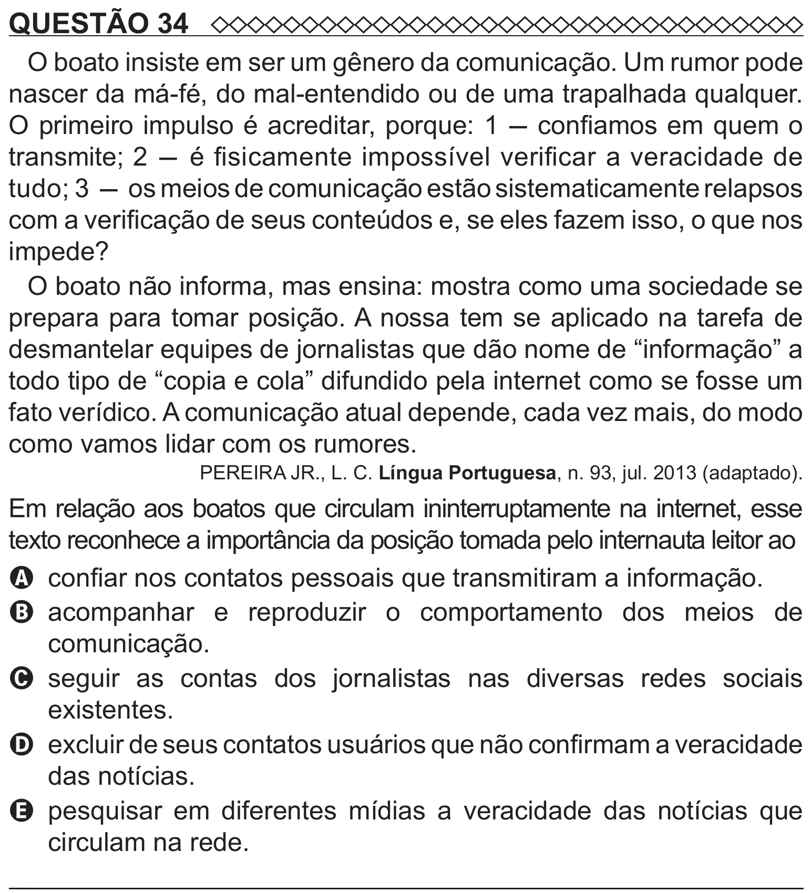

Texto extraído (pode conter ruído)

QUESTÃO 34  
O boato insiste em ser um gênero da comunicação. Um rumor pode  
nascer da má-fé, do mal-entendido ou de uma trapalhada qualquer.  
O primeiro impulso é acreditar, porque: 1 - confiamos em quem o  
transmite; 2 - é fisicamente impossível verificar a veracidade de  
tudo; 3 - os meios de comunicação estão sistematicamente relapsos  
com a verificação de seus conteúdos e, se eles fazem isso, o que nos  
impede?  
O boato não informa, mas ensina: mostra como uma sociedade se  
prepara para tomar posição. A nossa tem se aplicado na tarefa de  
desmantelar equipes de jornalistas que dão nome de “informação” a  
todo tipo de “copia e cola” difundido pela internet como se fosse um  
fato verídico. A comunicação atual depende, cada vez mais, do modo  
como vamos lidar com os rumores.  
PEREIRA JR., L. C. Língua Portuguesa, n. 93, jul. 2013 (adaptado).  
Em relação aos boatos que circulam ininterruptamente na internet, esse  
texto reconhece a importância da posição tomada pelo internauta leitor ao  
A confiar nos contatos pessoais que transmitiram a informação.  
B   
acompanhar e reproduzir o comportamento dos meios de  
comunicação.  
C   
seguir as contas dos jornalistas nas diversas redes sociais  
existentes.  
D excluir de seus contatos usuários que não confirmam a veracidade  
das notícias.  
E pesquisar em diferentes mídias a veracidade das notícias que  
circulam na rede.

