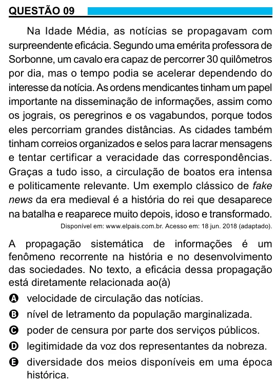

Texto extraído (pode conter ruído)

QUESTÃO 09  
Na Idade Média, as notícias se propagavam com  
surpreendente eficácia. Segundo uma emérita professora de  
Sorbonne, um cavalo era capaz de percorrer 30 quilômetros  
por dia, mas o tempo podia se acelerar dependendo do  
interesse da notícia. As ordens mendicantes tinham um papel  
importante na disseminação de informações, assim como  
os jograis, os peregrinos e os vagabundos, porque todos  
eles percorriam grandes distâncias. As cidades também  
tinham correios organizados e selos para lacrar mensagens  
e tentar certificar a veracidade das correspondências.  
Graças a tudo isso, a circulação de boatos era intensa  
e politicamente relevante. Um exemplo clássico de fake  
news da era medieval é a história do rei que desaparece  
na batalha e reaparece muito depois, idoso e transformado.  
Disponível em: www.elpais.com.br. Acesso em: 18 jun. 2018 (adaptado).  
A propagação sistemática de informações é um  
fenômeno recorrente na história e no desenvolvimento  
das sociedades. No texto, a eficácia dessa propagação  
está diretamente relacionada ao(à)  
A velocidade de circulação das notícias.  
B nível de letramento da população marginalizada.  
C poder de censura por parte dos serviços públicos.  
D legitimidade da voz dos representantes da nobreza.  
E diversidade dos meios disponíveis em uma época  
histórica.

