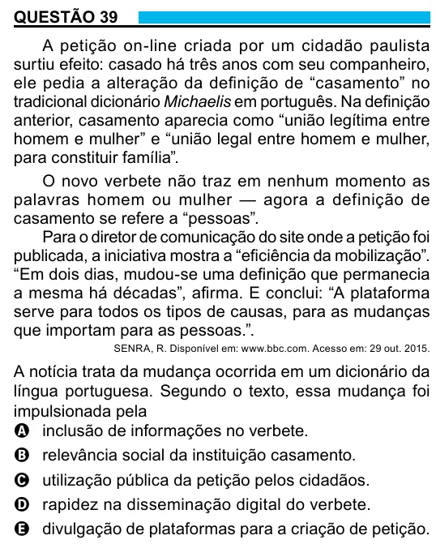

Texto extraído (pode conter ruído)

QUESTÃO 39  
A petição on-line criada por um cidadão paulista  
surtiu efeito: casado há três anos com seu companheiro,  
ele pedia a alteração da definição de “casamento” no  
tradicional dicionário Michaelis em português. Na definição  
anterior, casamento aparecia como “união legítima entre  
homem e mulher” e “união legal entre homem e mulher,  
para constituir família”.  
O novo verbete não traz em nenhum momento as  
palavras homem ou mulher — agora a definição de  
casamento se refere a “pessoas”.  
Para o diretor de comunicação do site onde a petição foi  
publicada, a iniciativa mostra a “eficiência da mobilização”.  
“Em dois dias, mudou-se uma definição que permanecia  
a mesma há décadas”, afirma. E conclui: “A plataforma  
serve para todos os tipos de causas, para as mudanças  
que importam para as pessoas.”.  
SENRA, R. Disponível em: www.bbc.com. Acesso em: 29 out. 2015.  
A notícia trata da mudança ocorrida em um dicionário da  
língua portuguesa. Segundo o texto, essa mudança foi  
impulsionada pela  
A inclusão de informações no verbete.  
B relevância social da instituição casamento.  
C utilização pública da petição pelos cidadãos.  
D rapidez na disseminação digital do verbete.  
E divulgação de plataformas para a criação de petição.

