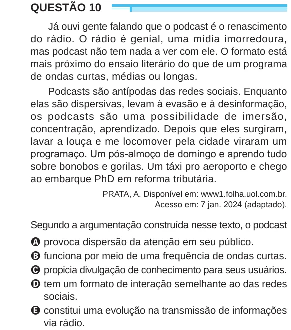

Texto extraído (pode conter ruído)

QUESTÃO 10  
Já ouvi gente falando que o podcast é o renascimento  
do rádio. O rádio é genial, uma mídia imorredoura,  
mas podcast não tem nada a ver com ele. O formato está  
mais próximo do ensaio literário do que de um programa  
de ondas curtas, médias ou longas.  
Podcasts são antípodas das redes sociais. Enquanto  
elas são dispersivas, levam à evasão e à desinformação,  
os podcasts são uma possibilidade de imersão,  
concentração, aprendizado. Depois que eles surgiram,  
lavar a louça e me locomover pela cidade viraram um  
programaço. Um pós-almoço de domingo e aprendo tudo  
sobre bonobos e gorilas. Um táxi pro aeroporto e chego  
ao embarque PhD em reforma tributária.  
PRATA, A. Disponível em: www1.folha.uol.com.br.  
Acesso em: 7 jan. 2024 (adaptado).  
Segundo a argumentação construída nesse texto, o podcast  
A provoca dispersão da atenção em seu público.  
B funciona por meio de uma frequência de ondas curtas.  
C propicia divulgação de conhecimento para seus usuários.  
D tem um formato de interação semelhante ao das redes  
sociais.  
E constitui uma evolução na transmissão de informações  
via rádio.

