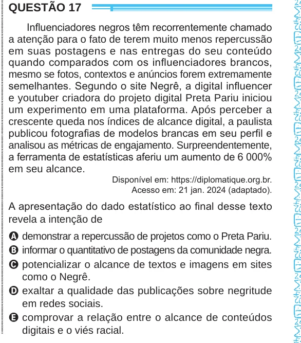

Texto extraído (pode conter ruído)

QUESTÃO 17  
Influenciadores negros têm recorrentemente chamado  
a atenção para o fato de terem muito menos repercussão  
em suas postagens e nas entregas do seu conteúdo  
quando comparados com os influenciadores brancos,  
mesmo se fotos, contextos e anúncios forem extremamente  
semelhantes. Segundo o site Negrê, a digital influencer  
e youtuber criadora do projeto digital Preta Pariu iniciou  
um experimento em uma plataforma. Após perceber a  
crescente queda nos índices de alcance digital, a paulista  
publicou fotografias de modelos brancas em seu perfil e  
analisou as métricas de engajamento. Surpreendentemente,  
a ferramenta de estatísticas aferiu um aumento de 6 000%  
em seu alcance.  
Disponível em: https://diplomatique.org.br.  
Acesso em: 21 jan. 2024 (adaptado).  
A apresentação do dado estatístico ao final desse texto  
revela a intenção de  
A demonstrar a repercussão de projetos como o Preta Pariu.  
B informar o quantitativo de postagens da comunidade negra.  
C potencializar o alcance de textos e imagens em sites  
como o Negrê.  
D exaltar a qualidade das publicações sobre negritude  
em redes sociais.  
E comprovar a relação entre o alcance de conteúdos  
digitais e o viés racial.

